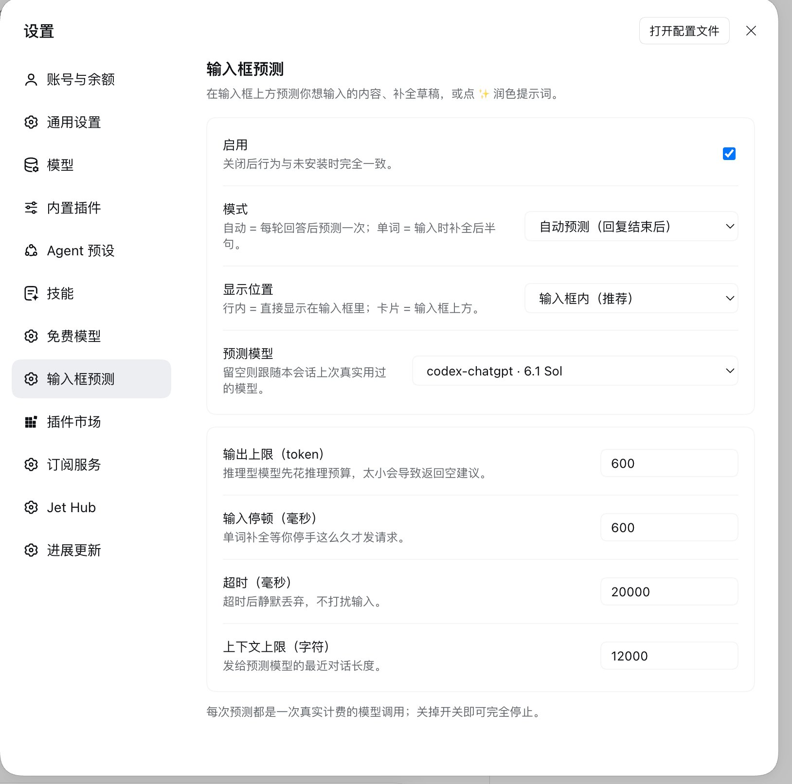

# 输入框预测 · Composer Assist

> **中文**：根据当前对话和你说话的方式，在输入框上方给出你下一条最可能发的消息，按 Tab 即可采用；同时支持输入时补全草稿、一键润色提示词。
>
> **English**: Predicts your next message in the DSH composer, based on your conversation and how you talk to it. Press Tab to take it. It also completes a draft as you type and rewrites a prompt for clarity on demand.

<p align="center">
  
</p>
<p align="center"><sub>输入框上方的独立建议栏，与输入框同宽对齐</sub></p>

<p align="center">
  
</p>
<p align="center"><sub>设置 → 输入框预测</sub></p>

## 功能 · Features

| 中文 | English |
|---|---|
| 自动预测 | Predicts the next message after each finished turn |
| 手动预测 | Predict on demand from the composer tool row |
| 草稿补全 | Completes the second half of a draft as you type |
| 润色提示词 | Rewrites the current draft into a clearer instruction |

按 **Tab** 接受建议（填进草稿但不发送），**Esc** 隐藏，「忽略」按钮则永久丢弃。草稿为空时 **←/→** 在候选之间切换（按住修饰键、或输入法正在组合时不会拦截方向键）。
Tab accepts a suggestion (fills the draft, does not send); Esc hides it; the dismiss button forgets it. With an empty draft, **←/→** cycles between candidates (arrows are left alone while a modifier is held or an IME is composing).

## 安装 · Install

已发布到 npm，直接装即可（当前版本 **0.7.4**）：

```bash
dsh plugin --profile desktop add dsh-composer-assist@latest
```

或在 DSH 的「插件」页安装 `dsh-composer-assist`，再在插件列表里启用。

Install from npm (current version **0.7.4**):

```bash
dsh plugin --profile desktop add dsh-composer-assist@latest
```

Or install `dsh-composer-assist` from the DSH Plugins page and enable it in the plugin list.

### 从源码安装（开发者）

```bash
git clone https://github.com/Lphehe/dsh-composer-assist.git
cd dsh-composer-assist
pnpm install --frozen-lockfile
pnpm run build
pnpm run selfcheck
```

再让 DSH 以目录方式加载该 bundle：

```
plugin_manager install_bundle  target: <克隆目录的绝对路径>
```

本地已链接的开发目录不要再装第二份，DSH 一次只应加载一处。

### From source (developers)

Clone, run `pnpm install --frozen-lockfile`, `pnpm run build` and `pnpm run selfcheck`, then load the directory as a bundle with `plugin_manager install_bundle`. Do not keep both a linked development directory and an npm copy active at once.

## 文档 · Docs

- [市场投稿规范 · Market submission rules](<docs/market-submission.md>) —— 收录到 DSH 插件市场的硬性要求与本插件的提交状态
- [原生链路验收 · Native path verification](<docs/openrouter-dsh-verification.md>) —— OpenRouter 经宿主原生 LLM 链路的实测记录

## 设置 · Settings

设置 → **输入框预测** · Settings → **Composer prediction**

| 中文 | English |
|---|---|
| 启用 | Enable |
| 接受学习（默认关闭，可清除统计） | Acceptance learning (off by default, with a clear-stats button) |
| 模式：自动 / 单词补全 / 两者 / 仅手动 | Mode: auto / word / both / manual only |
| 显示位置：建议栏 / 行内 | Display: bar above the box / inline |
| 预测模型（留空则跟随本会话） | Predict model (blank follows the session) |
| 输出上限 / 输入停顿 / 超时 / 上下文上限 | Output cap / debounce / timeout / context cap |
| 置信度门槛（0 保留全部） | Confidence bar (0 keeps everything) |

设置存于 `$DSH_HOME/composer-assist/settings.json`。
Settings live in `$DSH_HOME/composer-assist/settings.json`.

建议栏上的「置信度」是模型的自评，只显示为高/中/低三档，不是校准过的概率。
The confidence on the bar is the model's own rough self-assessment, shown only as high/medium/low — not a calibrated probability.

## 请求耗时 · Request timing

预测、补全和润色请求会在输入框上方显示一行状态。进行中只更新本地总等待和已知的响应校验阶段；完成或超时后显示 **排队 / 准备 / 模型 / 校验** 的毫秒或秒数，超时标明最后已知阶段。未取得的数据为 `—`，只取得浏览器校验部分时用 `≥` 标明下界，不猜测服务端阶段。

- 排队：等待同类上一笔尚未退出的辅助调用，不含输入防抖。
- 准备：读取上下文、拼接提示词、解析路由和 `prepareCall`。
- 模型：实际流式调用，含网络和供应商内部等待，不能当作纯计算时间。
- 校验：Host 来源/候选校验，加浏览器响应解析与来源核对；总时间还包含少量传输、页面开销。

统计仅在当前页面内存中保留最近 8 个会话的最新请求，不记录正文、不写会话日志或磁盘；刷新清除。无新增轮询或付费调用，旧请求不能覆盖新请求统计，现有硬超时、草稿与候选保护保持不变。

Prediction, completion and polish show elapsed time while waiting and measured queue/prepare/model/validate durations after completion or timeout. Unknown durations stay unknown; model time includes provider/network wait. Only the latest request for 8 sessions is retained in page memory, without prompt text, polling or extra model calls.

## 设计要点 · Design notes

- **不写会话日志**：预测是 `ctx.llm.prepareCall()` 的辅助调用，不进入对话历史。
  **Never writes to the session log**: prediction is an auxiliary `ctx.llm.prepareCall()` call.
- **每轮只预测一次**：Host 侧监听 `agent/turn-stopping` 记账；预测自身产生的 turn 事件会被过滤，并按 turn 号去重。
  **Exactly one prediction per finished turn**: the Host records `agent/turn-stopping`, filters the prediction's own turn events, and deduplicates by turn number.
- **打字不触发**：轮询不依赖草稿内容，键击不会重启轮询或消耗 turn。
  **Typing never triggers it**: polling does not depend on draft content, and keystrokes neither restart the poll nor consume a turn.
- **建议跟着会话走**：建议与「生成中」状态都按会话保存在模块级存储，切换对话再切回不会丢失。
  **Suggestions belong to their conversation**: both the suggestion and the generating state are kept per session in a module-level store, so switching away and back does not lose them.
- **不抢宿主的命令提示**：行内模式会避让宿主的 `--dsh-composer-hint`。
  **Does not steal the host's hint**: inline mode avoids the host's `--dsh-composer-hint`.
- **工作区上下文只给名字**：工作目录顶层文件名与 git 分支/改动列表会随提示词一起发送，经宿主 `fs` / `subprocess` provider 读取。不读文件内容，过滤常见凭据类文件名；目录最多扫描 200 项、发送 8 个文件名和 20 行 git 状态，缺失或超时不阻断预测。
  **Workspace context is names only**: top-level file names plus the git branch and changed-file list ride along with the prompt through the Host `fs` / `subprocess` providers. No file contents are read; common credential-shaped names are filtered. Scanning is capped at 200 entries, with 8 names and 20 git status lines sent; missing context or a timeout does not fail the prediction.

## 实现说明 · Implementation notes

`display: inline`（行内模式）在空草稿上显示一个非编辑预览，与编辑器共享网格区域并隐藏 placeholder；换行会撑开输入区域。草稿补全复用宿主的 `--dsh-composer-hint`，跟随文字末尾排版。继续编辑使原建议与草稿不匹配时，行内预览隐藏，候选仍保留在建议栏。接受、切换会话或退出行内模式时会清理插件拥有的提示。

Inline mode shows a non-editable preview over an empty editor, shares its grid area, and hides the placeholder; wrapped text expands the input area. Draft continuations use the host's `--dsh-composer-hint` at the end of the text. Editing a draft hides a mismatched inline preview while keeping the candidate in the suggestion bar. Accepting, switching sessions, or leaving inline mode clears the plugin's own hints.

预览使用清晰的灰色，常显「预览 · 未填入草稿」与键盘提示；只有 Tab 或接受按钮会填入草稿。候选、选中位置和生成状态按会话保存在页面内存中，切换会话及重载插件会恢复；整页刷新会清空这份内存缓存。

Readable gray text and visible preview/keyboard hints distinguish suggestions from the draft; only Tab or the accept button inserts them. Per-session candidates, selection, and generation state survive session switches and plugin remounts in page memory. A full page refresh clears this cache.

行内显示依赖宿主的 `[data-composer-card]` / `[data-composer-input]` 标记及原生提示样式；DSH 升级改名后需要适配。Tab 接受也依赖消息输入框标记，以免搜索等其他输入框误接受候选。

Inline rendering relies on the host's composer markers and native hint styles, which may need adapting after a DSH upgrade. Tab acceptance also checks the message-editor marker so other editable fields, such as search, cannot accept a candidate.

## 成本提醒 · Cost warning

**每次预测都是一次真实计费的模型调用。** 默认开启自动模式，即每轮回答后一次调用。可在设置中改为「仅手动」或直接关闭。

**Every prediction is a real, billed model call.** With auto mode on, that is one call after each finished turn. Switch to manual-only, or turn the plugin off, in the settings page.

## 自检 · Self-check

克隆仓库后运行 `pnpm run selfcheck`：它检查解析、学习统计、上下文失败降级，并确认提交的 `dist/` 与当前源码一致；不调用模型或改写用户设置。
After cloning, run `pnpm run selfcheck`: it covers parsing, learning counters and context fallback, and verifies the committed `dist/` matches the current source. It does not call a model or change user settings.

## 许可证 · License

原创程序代码采用“源码可见、禁止修改”条款，并非开放源代码许可证。允许使用未经修改的版本；未经著作权人事先书面许可，不得修改本软件、制作衍生版本或分发修改版本。完整条款见 [LICENSE](LICENSE)。用户自己的配置、输入、输出和工作流脚本不受本项修改限制。

The original program code is source-available under use-permitted, modification-prohibited terms, not an open-source license. Use of the unmodified software is permitted; modification or derivative versions require the copyright holder's prior written permission. See [LICENSE](LICENSE). These restrictions do not apply to users' own configuration, input, output or workflow scripts.

第三方组件仍按其原许可证授权，不适用上述修改限制。移植的 ZCode 保留 Apache-2.0，TypeScript 库保留其原许可；来源与许可声明见仓库中的 `vendor/zcode/PROVENANCE.md`。

Third-party components retain their original licenses and are not subject to the modification restriction above; see `vendor/zcode/PROVENANCE.md` in the repository.
