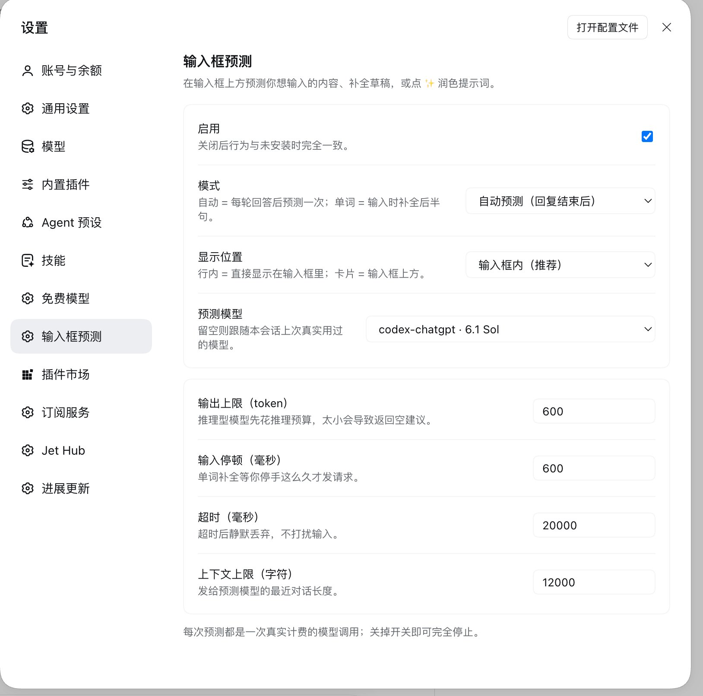

# 输入框预测 · Composer Assist

为 [DeepSeek Harness](https://github.com/deepseek-ai/deepseek-harness) 提供下一条消息预测、草稿补全和提示词润色。根据当前对话给出建议，按 **Tab** 填入输入框，由你决定是否发送。

A DeepSeek Harness plugin for next-message prediction, draft completion, and prompt polishing. Press **Tab** to insert a suggestion; you decide whether to send it.

<p align="center">
  
</p>
<p align="center"><sub>预测建议 · Prediction above the composer</sub></p>

## 功能 · Features

- **预测下一条消息**：回答结束后自动预测，也可手动触发；支持多个候选。
- **补全草稿**：输入时建议自然的后半句。
- **润色提示词**：让当前草稿更清晰，同时保留原意。
- **会话与草稿保护**：建议按会话保存，过期结果不会覆盖新的输入。

Predict the next message automatically or on demand, complete a draft, and polish a prompt. Suggestions stay with their conversation, and stale responses do not overwrite newer input.

**Tab** 接受建议，**Esc** 隐藏；草稿为空时可用 **← / →** 切换候选。接受只填入草稿，不会自动发送。

**Tab** inserts a suggestion, **Esc** hides it, and **← / →** switch candidates when the draft is empty. Accepting never sends the message.

## 安装 · Install

在 Harness 中让助手使用 `plugin_manager install_bundle` 安装以下预打包版本，无需构建：

Ask the Harness assistant to install this prepacked bundle with `plugin_manager install_bundle`:

```text
https://github.com/Lphehe/dsh-composer-assist/releases/download/v0.1.1/dsh-composer-assist.tgz
```

普通 CLI profile 也可以使用下列命令；把 `web` 替换为你的 profile 名。Desktop 请使用插件管理器。

For a CLI profile, replace `web` with your profile name. Use Plugin Manager for Desktop.

```bash
dsh plugin --profile web add https://github.com/Lphehe/dsh-composer-assist/releases/download/v0.1.1/dsh-composer-assist.tgz
```

也可以克隆本仓库，然后通过 `plugin_manager install_bundle` 安装克隆目录的绝对路径。

You can also clone this repository and install its absolute directory path with `plugin_manager install_bundle`.

```bash
git clone https://github.com/Lphehe/dsh-composer-assist.git
```

## 设置 · Settings

在 **设置 → 输入框预测** 中选择模式、显示位置、预测模型和超时等选项。接受学习默认关闭；置信度是模型自评，不是经过校准的正确率。

Use **Settings → Composer prediction** to choose the mode, display, model, timeout, and other options. Acceptance learning is off by default. Confidence is a model estimate, not calibrated accuracy.

<p align="center">
  
</p>
<p align="center"><sub>设置页面示例 · Settings example</sub></p>

每次预测都会发起一次可能计费的模型调用。默认自动模式在每轮回答后预测一次；可切换为仅手动或关闭插件。上下文包括近期对话和有限的工具结果，以及工作区顶层文件名和 Git 状态；不会读取工作区文件内容。

Predictions make model calls that may incur charges. Auto mode predicts after each completed turn; switch to manual mode or disable the plugin in settings. Context includes recent conversation, bounded tool results, top-level filenames and Git status; workspace file contents are not read.

## 开发进展 · Development update

自动续接、动态工作流、监控、角色库及新增决策能力正在开发，**不包含在公开的 v0.1.1 安装包中**。它们的表现和验收取决于宿主、会话及模型配置。

Automatic continuation, dynamic workflows, monitoring, roles, and newer decision features are in development and **are not included in the public v0.1.1 bundle**. Their behavior and verification depend on the host, session, and model configuration.

## 自检与反馈 · Self-check and feedback

运行 `node selfcheck.mjs` 可检查解析、学习统计和上下文失败降级；该自检不会调用模型。问题和建议欢迎加入 QQ 群 **1129389677**。

Run `node selfcheck.mjs` for parser, learning-counter, and context-fallback checks; it does not call a model. For feedback, join QQ group **1129389677**.

## 许可证 · License

原创程序代码采用“源码可见、禁止修改”条款，并非开放源代码许可证。允许使用未经修改的版本；未经著作权人事先书面许可，不得修改本软件、制作衍生版本或分发修改版本。完整条款见 [LICENSE](LICENSE)。用户自己的配置、输入、输出和工作流脚本不受本项修改限制。

The original program code is source-available under use-permitted, modification-prohibited terms, not an open-source license. Use of the unmodified software is permitted; modification or derivative versions require the copyright holder's prior written permission. See [LICENSE](LICENSE). These restrictions do not apply to users' own configuration, input, output or workflow scripts.
