# DeepSeek Harness 架构分层与插件层深潜

> 注：为提交到公开仓库，本文把审查机器的本地路径替换为占位符：`<DSH_INSTALL_DIR>` = DSH 运行时安装目录，`<DSH_REPO_CHECKOUT>` = deepseek-harness 仓库检出，`<PLUGIN_CHECKOUT>` = dsh-composer-assist 仓库检出，`<REVIEW_DIR>` = 审查材料目录。行号与结论不受影响。
> **交付文档 01** ｜ 团队内部分享版 ｜ 主题：DSH（DeepSeek Harness）的运行时分层、插件机制，以及外部插件作者真正需要握住的契约面。

| 项 | 值 |
|---|---|
| 适用运行时 | DeepSeek Harness `0.2.1-rc.2`（npm `next` 通道，本机实测） |
| 本机安装路径 | `<DSH_INSTALL_DIR>/`（含 `lib/bin.js`、`lib/types/*.d.ts`、`node_modules/@deepseek-ai/` 共 305 个包） |
| 官方仓库证据基线 | `<DSH_REPO_CHECKOUT>`，`main`，commit `22ddee3`（2026-10），稀疏检出 `docs/`、`packages/boot/plugin-manager`、`packages/client`、`apps/desktop`、`apps/cli` |
| 用户原始架构文本 | 已逐条整合，并在第 ⑤ 章做事实核对（表格形式，含证据路径与判定） |
| 文档定位 | 承上启下：为 Doc2《dsh-composer-assist 可行性议题》提供架构底座 |

---

## ① 摘要与阅读指引

### 1.1 三句话结论

1. **DSH 的确是"微内核 + 全插件"，但微内核不是 C ABI 宿主**：整棵运行时是一张 **Cordis 插件图**，能力以 `ctx.<服务名>` 的稳定槽位暴露，模型适配器、工具注册表、会话日志、**乃至 agent loop 本身**都是可替换插件（`docs/architecture.zh.md:9`）。
2. **分层数不是三层，而是"宿主平台 + Cordis 内核 + Host 插件 + Client 插件 + 分发层（bundle/profile）"**：用户文本把 Web 客户端塞进"插件实现层"的"UI 界面"一格，实际上浏览器半边是一套独立的 Cordis 应用（`docs/subsystems/web-client.zh.md:1-5`），有自己的加载器、模块系统与组装协议。
3. **用户文本的"设计哲学"基本成立，平台细节大量失真**：`Rust/winit PAL`、`C ABI 的 .so/.dylib 加载`、`serde_json IPC`、`~/.dsh/plugins 扫描`、`ctx.llmStreams` 五条均与实现不符或查无实据；`沙箱三平台方案`、`session/event`、`cordis.patch.yml 热插拔` 三条成立（细节需修正）。逐条见第 ⑤ 章。

### 1.2 证据纪律与标注约定

本文所有 API 名、事件名、服务名、文件路径均来自 `<DSH_REPO_CHECKOUT>` 或本机安装包，并按下表标注强弱；推断一律显式标注，查不到的写"未验证"。

| 标记 | 含义 | 判定标准 |
|---|---|---|
| ✅ **代码事实** | 可在安装包 `.js` / `.d.ts` / `package.json` 中直接读到 | 给出安装路径或 `git show` 可复现 |
| 📄 **官方文档** | 出现在仓库 `docs/` 或已发布包 README | 给出 `<repo 相对路径>:<行号>` |
| 🧩 **文档+代码一致** | 文档描述与随包产物互证 | 两者都给出 |
| ⚠️ **推断** | 由结构或行为反推，未见明文声明 | 明确写"推断" |
| ❓ **未验证** | 无法在证据面内确认 | 写明原因（缺包/缺文档/需运行） |

**路径约定**：`docs/...`、`packages/...`、`apps/...` 均指官方仓库 `deepseek-harness`（本地副本 `<DSH_REPO_CHECKOUT>`）内路径；凡以 `node_modules/@deepseek-ai/...` 开头者指本机安装目录内的文件。行号对应 commit `22ddee3` 与 `0.2.1-rc.2` 产物，升级后需重跑一次核对。

### 1.3 三条阅读路线

| 读者 | 建议路线 | 耗时 |
|---|---|---|
| 只想改插件、不关心架构 | ③.3.1 → ③.3.2 → ③.3.9 → ③.3.10 → ⑦ | ~15 min |
| 要评估"官方契约稳不稳" | ③.3.3 → ③.3.4 → ⑤ → ⑥ | ~30 min |
| 要给别人讲清 DSH | 通读 ② → ④ → ⑤ | ~60 min |

---

## ② 分层总览

### 2.1 一句话剖面

一次 `dsh --profile web` 启动，实际发生的是：**launcher 读 profile → 叠加有序 bundle patch 层 → 得到一张 Loader 配置树 → 逐行 `import()` 插件模块 → Cordis 按服务依赖求解激活顺序 → Host 进程起来 → 浏览器侧再拉一份 `__DSH_BOOT__` 图，用另一套 Cordis 实例把 UI 插件装起来**（`docs/architecture.zh.md:15-45`、`docs/subsystems/web-client.zh.md:22-26`）。

### 2.2 实际分层（用户原图 ↔ 实现对应）

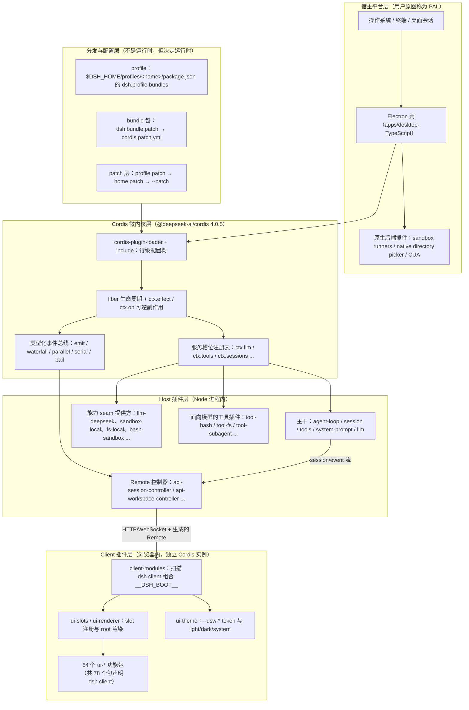

### 2.3 用户原图与实际实现对应表

| 用户原图的分层 | 用户描述的关键点 | 实际实现（对应到上面的层） | 差异性质 |
|---|---|---|---|
| **平台抽象层 PAL**（Rust + winit） | 原生窗口、系统事件分发、统一 IPC（IPC Channel + serde_json） | **无此层**。桌面端是 **Electron 壳**（`apps/desktop/README.zh.md:30`，`apps/desktop/package.json` 依赖 `electron ^44.7.0`）；"平台适配"由一批 **Host 插件 + 原生后端**分担（sandbox runner、native directory picker、CUA 驱动）；跨进程通信是 **HTTP/WebSocket 上的生成式 Remote（Typert）**，不是 serde_json IPC | 结构性错误 |
| **Cordis 微内核层** | 插件扫描 `~/.dsh/plugins/`、C ABI 动态加载 `.so/.dylib`、服务注册与发现、约定频道事件总线 | 内核确实是 Cordis，但：插件是 **ESM 模块** `import()`，不是 C ABI；装载单位是 **profile → bundle → Loader 行**，不是目录扫描；事件是 **TypeScript 声明合并的类型化事件**，不是字符串约定频道 | 一半正确（Cordis 内核）+ 一半错误（装载机制） |
| **插件实现层** | 模型适配器 `ctx.llm`/`ctx.llmStreams`、工具 `ctx.tools`、会话 `ctx.sessions`、循环 `ctx.agentLoop`、沙箱 `ctx.sandbox`、系统提示词 `ctx.systemPrompt`、UI 与 WebView 通信 | 槽位名大体正确（`ctx.llm`、`ctx.tools`、`ctx.sessions`、`ctx.agentLoop`、`ctx.sandbox`、`ctx.systemPrompt` 全部真实存在，`ctx.llmStreams` 不存在）；**UI 是独立的 Client 插件图**，不是"WebView 通信"；沙箱细节基本正确 | 大体正确 + 细节修正 |

### 2.4 为什么要把"插件实现层"拆成 Host / Client 两半

用户文本把 UI 写成"UI 界面（事件与 WebView 通信）"，这是最容易误导后续判断的一处。实际实现里：

- 浏览器端有**独立的一套 Cordis**：`window.__DSH_BOOT__` 承载组合后的入口图，`client-modules` 的浏览器半边是一张 lazy CommonJS 表，materialize 时才跑 factory（`docs/subsystems/web-client.zh.md:24`、`docs/subsystems/client-modules.zh.md:5`）。
- UI 插件声明 `dsh.client`、导出 `./client`，**不通过 HTTP 事件与宿主"通信"，而是通过生成式 Remote**（`ctx.remote.<namespace>` / `agentCtx.remote.<namespace>`）调用 Host controller（`docs/subsystems/web-client.zh.md:28-34`）。
- 因此"UI 插件"是可热插拔的**客户端插件**，与 Host 插件共用 `apply(ctx, config)` 的写法，但处在不同进程、不同依赖注入环境。

这一点直接决定 Doc2 的一条主线：**composer-assist 是"一个包、两半"**（Host 行 + `dsh.client` 半边），它的失效模式天然分成"Host 没装上"和"Client 没渲染"两类。

### 2.5 本篇与官方文档的映射

| 想深入 | 读官方 | 本篇对应 |
|---|---|---|
| 分层与 core 包表 | `docs/architecture.zh.md` | ②、③.2、③.3.3 |
| 服务槽位全表 | `docs/capability-seams.zh.md`（含生成式 mermaid 图 + 表） | ③.3.3（精选 + 稳定性评级） |
| 事件生产/消费矩阵 | `docs/event-producer-consumer.zh.md` | ③.3.4、④ |
| 轮次/步骤时序 | `docs/agent-lifecycle.zh.md` | ④ |
| Cordis 语义 | `docs/cordis-primer.zh.md`、`docs/cordis-api/*.zh.md` | ③.2 |
| 工具流水线 | `docs/tool-execution-pipeline.zh.md`、`docs/subsystems/tools.zh.md` | ③.3.5 |
| 会话日志 | `docs/subsystems/session.zh.md` | ③.3.6 |
| 沙箱 | `docs/subsystems/sandbox.zh.md` | ③.3.7 |
| Web 客户端 | `docs/subsystems/{web-client,client-modules,slots}.zh.md` | ③.3.8 |
| 配置与 patch | `packages/boot/app-boot/README.zh.md` | ③.3.9 |
| 版本兼容 | `docs/upgrade-guide/v0.2.1-*/`、`packages/boot/plugin-manager/README.zh.md` | ③.3.10 |

---

## ③ 逐层展开

### 3.1 宿主平台层：没有 PAL，只有"Electron 壳 + Node Host + 原生后端"

#### 3.1.1 用户所称 PAL 的真实对应物

用户文本把"平台抽象层（PAL）"描述为 Rust + winit 的原生窗口/事件/IPC 适配器。实测结论是：**这一层在 DSH 里不存在统一实现，其职责被拆散到三个不相关的位置**。

| 用户 PAL 的职责 | DSH 实际承担者 | 证据 |
|---|---|---|
| 原生窗口初始化 | Electron BrowserWindow（`apps/desktop`） | `apps/desktop/README.zh.md:30`："桌面应用是完整 dsh Web 应用外的一层 Electron 壳" |
| 系统事件分发（热键/托盘/拖放/屏幕变化） | Electron 壳自有菜单/快捷键/托盘 + Client 插件 `ui-shortcuts`、`ui-file-drag`、`ui-shortcuts` 的物理键分发 | `apps/desktop/README.zh.md`（托盘、菜单、DevTools 快捷键章节）；`docs/subsystems/web-client.zh.md:7`（快捷键归属） |
| 统一 IPC 通道（IPC Channel + serde_json） | ①浏览器侧：**HTTP/WebSocket**（`client/connection` + `api/gateway` + Typert Remote）；②Electron 主进程↔Host：**私有 Node IPC**，只承载启动注入、就绪、致命错误与关闭 | `docs/subsystems/web-client.zh.md:28-34`；`docs/architecture.zh.md:53`（"Node IPC 承载启动注入、就绪、致命错误与关闭"） |
| 平台能力适配 | 以插件形式提供：`sandbox-local`（三平台 runner）、`host-directory-picker-native`、`host-directory-picker-browse`、CUA 原生驱动 | `docs/capability-seams.zh.md:645`、`:651`、`:730`；`docs/subsystems/sandbox.zh.md:5` |
| Rust 实现 | **零个 `.rs` 文件**；仓库内唯一的 C 产物是一个 12 行的 POSIX 符号链接小工具 | `git ls-tree -r HEAD \| grep '\.rs$'` → 0 命中；`apps/desktop/cli/link-entry.c:1-20` |

> **一个容易误读的细节**：`apps/desktop/cli/link-entry.c` 是全仓库唯一的原生源码，它只做一件事——用 `linkat()` 创建符号链接并拒绝覆盖已有目标（`apps/desktop/cli/link-entry.c:6-18`）。它不是插件 ABI，也不是 PAL。

#### 3.1.2 平台差异真实落在哪

平台差异并没有被"抽象掉"，而是**下沉到 seam 的提供方**里，这是 DSH 与"传统 PAL"在哲学上的关键分歧：

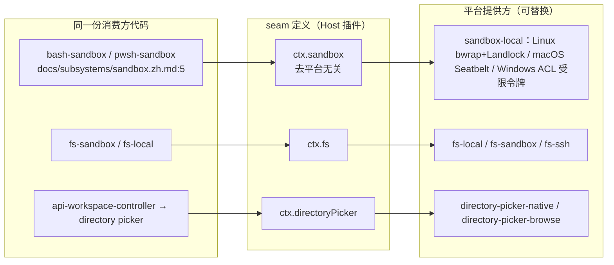

| 平台 | 沙箱实现 | 证据 |
|---|---|---|
| Linux | `bwrap` 只读绑定 + Landlock（较旧 Landlock ABI 会报告 `partial`） | `docs/subsystems/sandbox.zh.md:5`、`:30`、`:143` |
| macOS | Seatbelt（拒绝时 stderr 为 `EPERM`） | 同上 `:144` |
| Windows | ACL 受限令牌；无显式可写根、报告部分强制执行（硬链接/读取不受限/AppContainer 边界） | `docs/subsystems/sandbox.zh.md:11`、`:30` |

#### 3.1.3 结论

- "PAL"这个词在官方文档中**零出现**（`grep -rn 'PAL' docs/` 无命中），本章的对应关系属于**本文的重构**（⚠️ 推断层：术语映射是分析，不是官方命名）。
- 对插件作者的影响：**你几乎永远不会碰"平台层"**。你面对的是 seam（`ctx.sandbox` / `ctx.fs` / `ctx.shell` / `ctx.subprocess`），跨平台由提供方插件决定。这也是为什么 DSH 可以把"远程沙箱"实现成一次提供方替换：把 fs 与 subprocess 指向远端，Bash、PTY、LSP 会一起搬过去（`docs/architecture.zh.md:142`）。

---

### 3.2 Cordis 微内核层

#### 3.2.1 Cordis 是什么、从哪来

| 事实 | 值 | 证据 |
|---|---|---|
| 包名 | `@deepseek-ai/cordis` | `node_modules/@deepseek-ai/cordis/package.json:2` |
| 版本 | `4.0.5` | 同文件 `version` 字段 |
| 来源 | **vendor 进主仓库**，目录 `vendor/cordis`，仓库仍指向 `deepseek-ai/deepseek-harness` | 同文件 `repository.directory: "vendor/cordis"`；`docs/cordis-primer.zh.md:5`（"以 vendor 方式引入"） |
| 上游作者 | Shigma（`author` 字段），上游项目即 Cordis 插件框架 | `node_modules/@deepseek-ai/cordis/package.json` `author` |
| 加载器 | `@deepseek-ai/cordis-plugin-loader`、`@deepseek-ai/cordis-plugin-include`（peer，optional）、`cordis-plugin-timer` | `node_modules/@deepseek-ai/dsh/package.json` dependencies |

> 注意版本号：`@deepseek-ai/cordis` 是 **4.x**，而 DSH 运行时是 **0.2.1-rc.2**。两者独立演进，讨论"Cordis 版本"时不要和 DSH 版本混为一谈。

#### 3.2.2 五个核心概念（照抄官方定义，不改写）

| 概念 | 官方表述 | 证据 |
|---|---|---|
| **插件** | 实现 Service 的对象：带可选 `inject` 与 `apply(ctx)` 的函数，或 `Service` 子类 | `docs/cordis-primer.zh.md:9` |
| **上下文** | 服务的容器；服务占据稳定的 `ctx.<key>`（如 `ctx.tools`、`ctx.llm`、`ctx.sessions`），通过 key 查找而非导入实现 | `docs/cordis-primer.zh.md:10` |
| **inject** | 声明服务依赖，等依赖就绪才启动；**加载顺序由服务依赖表达**，不手工编排 | `docs/cordis-primer.zh.md:11` |
| **类型化事件** | 通过 TS 声明合并注册事件名，再以 `emit`/`waterfall`/`parallel`/`serial`/`bail` 分发 | `docs/cordis-primer.zh.md:12` |
| **可逆副作用** | 提示词片段、工具 schema、适配器、监听器通过 `ctx.effect()` / `ctx.on()` 安装，reload/teardown 时撤销 | `docs/cordis-primer.zh.md:13` |

五种分发模式是**公开契约的一部分**（`docs/cordis-primer.zh.md:21-27`）：

| 模式 | await | 顺序 | 返回值 | 语义 |
|---|---|---|---|---|
| `emit` | 否 | 注册序观察 | 无 | 广播 |
| `waterfall` | 否 | 注册序 | 有 | 环绕中间件，`(...args, next)`；不调 `next()` 即短路 |
| `parallel` | 是 | 全并行 | 无 | 并行扇出 |
| `serial` | 是 | 注册序 | 有 | 串行裁决 |
| `bail` | 否 | 注册序至首个 bail 值 | 有 | 竞争式短路 |

Waterfall 的关键语义：监听器**必须调用 `next()` 才能委托**下去；下游返回值经 `next()` 回到当前层，可被包装或替换（`docs/cordis-primer.zh.md:35-39`）。`agent/pre-step`、`agent/request`、`llm/stream`、三个 `tools/*` 都是 waterfall（`docs/architecture.zh.md:110`），这是"插件能拦模型请求/工具调用"的唯一正当入口。

#### 3.2.3 `ctx` 上真正的生命周期原语

| 原语 | 作用 | 证据 |
|---|---|---|
| `ctx.effect(execute, label?)` | 注册可清理的副作用；`execute` 返回 disposer 或接受 `ctx` | `docs/cordis-api/fiber.zh.md:10-24` |
| `ctx.on(name, listener, options?)` / `ctx.once` | 注册事件监听（自动成为 fiber 拥有的副作用） | `docs/cordis-api/events.zh.md:127`、`:151` |
| `ctx.emit/waterfall/parallel/serial/bail` | 五种分发 | `docs/cordis-api/events.zh.md`（第 33、99、10、53、76 行：emit、waterfall、parallel、serial、bail） |
| `ctx.inject(names, callback)` | 声明依赖并延迟执行回调；混入自 registry | `docs/cordis-api/context.zh.md:158-162`；`apps/...` 与真实插件代码中大量使用（如 `dsh-composer-assist/index.js:508`） |
| `ctx.get(name, strict?)` | 读取服务，**不要求 inject**（返回 `undefined` ≠ 服务不存在） | `docs/cordis-api/context.zh.md:239` |
| `ctx.plugin(...)` | 手动挂载插件 | `docs/cordis-api/context.zh.md:158` |

**红线级事实**（对插件作者是硬约束，本文把它提到架构层面）：未在 `inject` 中声明的 `ctx.<service>` 属性代理会**抛错**（源码文案 `cannot get property "x" without inject`），插件在该处中止，后续注册全部不发生，且不一定有可见诊断。这条来自随包技能 `dsh-plugin-construction` 的实测，机制与 `docs/cordis-api/context.zh.md:158`（registry 混入）一致。

#### 3.2.4 "无特权内核"成立吗？——成立，但要修一处

官方表述：*"不存在需要打补丁的特权内核：扩展 dsh 的方式是把插件挂载到其他插件旁边"*（`docs/architecture.zh.md:11`）。这在**扩展方式**上完全成立：新增模型提供方、工具、命令、UI 都不需要改核心。

但有两个现实修正：

1. **主干服务仍是"事实上的必需集合"**。app-boot 维护一份 `requiredIds`：`agent-loop`、`webserver`、`web-runtime`、`modules`、`connection`、`headless-runner`、`acp`、`sdk-jsonrpc-server`——缺任何一个，启动会拆除整个应用并以非零码退出（`node_modules/@deepseek-ai/dsh-app-boot/README.zh.md:43`）。所以"没有特权逻辑"应更精确地说：**没有特权业务逻辑，但有特权服务契约**。
2. **agent loop 是"唯一的具体循环插件"**。`ctx.agentLoop` 的服务角色被标为 `bundle`，且"扩展包依赖 dsh-agent 的事件和服务，而不依赖此包"（`docs/capability-seams.zh.md:707`）。也就是说循环可替换是**接口层面**的（`Agent` 接口 + `agent/*` 事件），而不是"换一个循环插件就能改行为"这么轻。

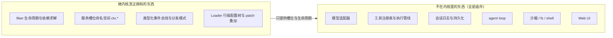

#### 3.2.5 启动链路（谁在读配置、谁在装插件）

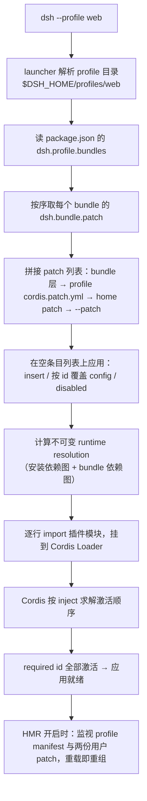

对应证据：`docs/architecture.zh.md:15-27`（层序与 patch 语义）、`node_modules/@deepseek-ai/dsh-app-boot/README.zh.md:50`（profile 位置与组成）、`:52`（版本兼容检查）、`:61`（patch 层优先级）、`:63`（HMR 监视范围）、`:138-140`（runtime resolution 与链接目录规则）。

---

### 3.3 插件实现层（深潜）

> 本节是全文重心。目标不是复述文档，而是回答一个工程问题：**作为一个外部插件作者，我能依赖什么、依赖了会怎么坏、坏了怎么发现。**

#### 3.3.1 插件的四种形态

DSH 里"插件"一词覆盖四种不同粒度，混用会导致严重的架构误判。它们的**声明位置、装载者、失败模式**全都不同。

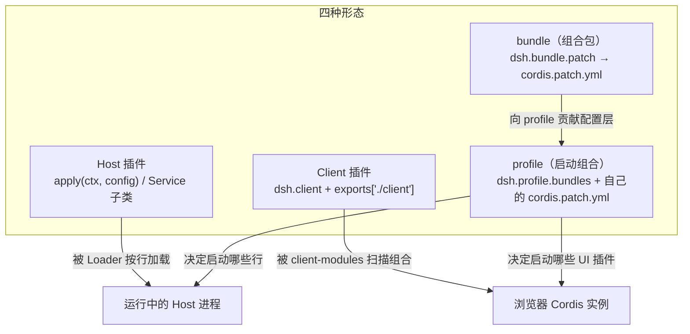

| 形态 | 声明方式 | 谁装载 | 典型产物 | 失败表现 | 证据 |
|---|---|---|---|---|---|
| **Host 插件** | ESM 模块，导出 `apply(ctx, config)` 或 `name/inject/Config`；也可默认导出 `Service` 子类 | Cordis Loader（一个 patch 行 = 一个模块说明符） | 工具、适配器、服务提供方、控制器 | 该行不激活；`--dump-config` 仍显示该行（配置存在但没跑起来） | `docs/cordis-primer.zh.md:9`；`docs/architecture.zh.md:25` |
| **Client 插件** | `package.json` 的 `dsh.client { platform, inject, immediately }` + `exports["./client"]` | `client-modules` 的 Host 半边扫描 loader entry，组合 `__DSH_BOOT__`，浏览器半边物化 | UI 功能包（54 个 `ui-*`；全部 78 个声明 `dsh.client` 的包中） | 页面不渲染该 slot；Host 无报错；启动审计把畸形声明聚合为 `AggregateError` | `docs/subsystems/client-modules.zh.md:94`、`:5` |
| **bundle（组合包）** | `package.json` 的 `dsh.bundle.patch` 指向一个 patch 文件或有序文件列表 | `app-boot` 的 `prepareProfilePatches` 在挂载前组合层 | `dsh-base`（96 行 insert）、`dsh-web-app`、`dsh-headless` 等 18 个 | 组合包被跳过并列入 `skippedBundles`（如版本不兼容、清单不可读） | `node_modules/@deepseek-ai/dsh-app-boot/README.zh.md:50-52`；`node_modules/@deepseek-ai/dsh-base/package.json` |
| **profile** | `$DSH_HOME/profiles/<name>/package.json` 的 `dsh.profile.bundles`（有序）+ 同目录 `cordis.patch.yml` | `dsh` launcher（唯一入口） | `web`/`headless`/`sdk`/`sdk-minimal`/`acp`/`desktop` | 启动失败或必需行缺失 | `docs/architecture.zh.md:17`；`node_modules/@deepseek-ai/dsh-app-boot/README.zh.md:50` |

**"没有东西同时是两者"**：bundle 是分发物，profile 是启动物。一个 npm 包若声明 `dsh.bundle` 就被 `dsh plugin add` 当作组合包加入 `dsh.profile.bundles`；只有 `dsh.client` 而没有 `dsh.bundle` 的包则只是一个"普通依赖"，不会自动进入配置层（随包技能 `dsh-plugin-construction` 与 `packages/boot/plugin-manager/README.zh.md:52` 一致）。

**实例：三种形态同时出现在一个小插件里**（`<PLUGIN_CHECKOUT>`，只读观察）：

```json
{
  "name": "dsh-composer-assist",
  "dsh": {
    "bundle": { "patch": "./cordis.patch.yml" },
    "client": {
      "platform": "web",
      "immediately": true,
      "inject": [
        "@deepseek-ai/dsh-client-ui-conversation",
        "@deepseek-ai/dsh-client-ui-settings",
        "@deepseek-ai/dsh-client-ui-settings-general"
      ]
    }
  },
  "exports": { ".": "./index.js", "./client": "./client.js", "./locale/*.json": "./locale/*.json", "./icon": "./icon.svg", "./package.json": "./package.json" }
}
```

它的 `cordis.patch.yml` 只有三行：`insert: - id: composer-assist / name: dsh-composer-assist`。**Host 半边一行，Client 半边被 `dsh.client` 声明，分发靠 `dsh.bundle`**——这就是 Doc2 要评估的最小样本。

#### 3.3.2 `apply(ctx, config)` 的生命周期

一个 Host 插件从被 import 到被卸载，经历四段：

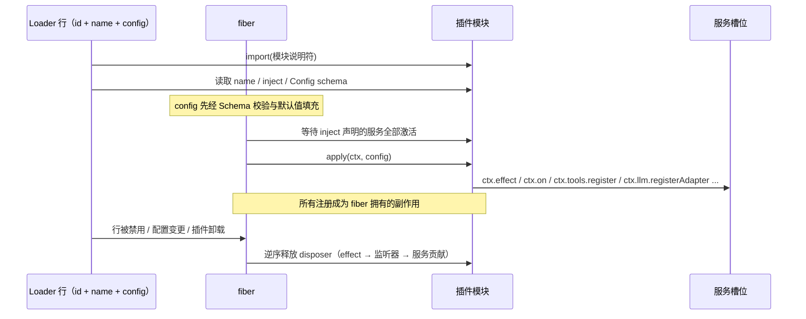

关键点：

1. **config 是行级配置，不是全局配置**。同一插件可以在一棵树里出现多行（不同 id、不同 config），例如 `plugin-manager` 与 `tool-plugin-manager` 是同一包的两个入口（`node_modules/@deepseek-ai/dsh-base/cordis.patch.yml` 的 insert 列表）。
2. **`apply` 里做的事必须是可逆的**。注册工具、注册服务、监听事件都返回 disposer；裸资源（定时器、子进程、文件句柄）必须放进 `ctx.effect()` 返回清理函数，否则 reload 会泄漏（`docs/cordis-primer.zh.md:13`、`docs/cordis-api/fiber.zh.md:10`）。
3. **服务依赖决定激活顺序，行顺序不决定**。`dsh-base` 的 patch 注释明确写："Row order carries no load semantics (activation is service-availability driven)"（`node_modules/@deepseek-ai/dsh-base/cordis.patch.yml:1-10`）。这句话否掉了"按 YAML 顺序初始化"的常见误判。
4. **失败策略分两档**：激活期（首次扫描）畸形声明会聚合成大声的 `AggregateError` 并让 fiber FAILED；稳态下损坏的包只记警告且不得殃及其他包（`docs/subsystems/client-modules.zh.md:96`，此条虽讲 Client 扫描，但 Host 侧的 `installFailLoud` 策略同理：`node_modules/@deepseek-ai/dsh-app-boot/README.zh.md:43`）。

**最小可用骨架**（真实 API，非伪代码）：

```ts
import type { Context } from '@deepseek-ai/cordis'
import Schema from '@deepseek-ai/schemastery'

export const name = 'my-plugin'
export const inject = ['tools']            // 必需服务；缺失则等待而非失败

export interface Config { enabled: boolean }
export const Config: Schema<Config> = Schema.object({
  enabled: Schema.boolean().default(true),
})

export function apply(ctx: Context, config: Config): void {
  if (!config.enabled) return

  // 注册型 API 自带 disposer，直接放回 effect 即可
  ctx.effect(() => ctx.tools.register(definition))

  // 监听型：ctx.on 自动绑定 fiber 生命周期
  ctx.on('tools/pre-execute', async (exec, next) => {
    // 想拦截：不调 next() 直接返回拒绝
    // 只观察：必须 next() 委托
    return next()
  })
}
```

（`ctx.inject` / `ctx.effect` / `ctx.on` 的语义见 `docs/cordis-api/context.zh.md:158`、`docs/cordis-api/fiber.zh.md:10`、`docs/cordis-api/events.zh.md:127`；骨架形状与真实插件一致，如 `node_modules/@deepseek-ai/dsh-client-ui-theme/package.json` 的 `dsh.client.inject` 与 `packages/boot/plugin-manager/README.zh.md:35-38` 的行覆盖示例。）

**关于 `ctx.inject` 的一个陷阱**：`ctx.get(name)` 不要求 inject，但**默认只返回已激活的实现**——返回 `undefined` 不等于服务不存在，可能只是提供方还没激活。需要严格语义时用 `ctx.get(name, true)`（strict），或干脆用 `inject` 等它（`docs/cordis-api/context.zh.md:239`）。

#### 3.3.3 服务槽位真实清单

官方全表在 `docs/capability-seams.zh.md`（生成式，约 100 个 `ctx.*` 键，740 行）。本节按"外部插件作者会不会用到"筛选并加上**稳定性评级**。评级是本文判断（⚠️），依据是三条可观察事实：是否写进 architecture 的核心包表、是否有正式 subystem 文档、是否有 generated Cordis catalog。

**评级口径**

| 评级 | 含义 | 判据 |
|---|---|---|
| A｜正式契约 | 官方文档承诺 + 生成式 API 目录 + 多提供方 | 可依赖；升级前仍要跑 `--dump-config` |
| B｜文档化但会动 | 有 subsystem 文档与 API 目录，但版本内已见签名变更 | 可依赖，需盯 upgrade-guide |
| C｜内部/实验 | `experimental-*` 或仅一处使用，无稳定承诺 | 不应作为产品依赖 |
| D｜非契约 | DOM 标记、CSS 变量、私有字段 | 只做降级容错，不做强依赖 |

**A/B 级：主干 + 能力 seam（精选 24 个）**

| `ctx.` 槽位 | 角色 | 提供方包 | 消费方式（真实 API 片段） | 评级 |
|---|---|---|---|---|
| `ctx.sessions` | core | `@deepseek-ai/dsh-session` | `ctx.sessions.create(id, { seed, meta })`、`Session.append()`、`deriveMessages()` | A |
| `ctx.tools` | core | `@deepseek-ai/dsh-tools` | `register()` / `restrict()` / `guard()` / `execute()` / `setExecutor()` | A |
| `ctx.llm` | seam | `dsh-llm`；实现 `dsh-llm-deepseek`、`dsh-llm-pi-ai`、`dsh-llm-replay` | `registerAdapter(providers, adapter)`、`prepareCall(config, signal, configure)`、`stream(options)` | A |
| `ctx.systemPrompt` | core | `@deepseek-ai/dsh-system-prompt` | 贡献提示词片段；`system-prompt/assemble` waterfall | A |
| `ctx.agents` | core | `@deepseek-ai/dsh-agent` | `turnBoundaryOf()`、`withInitiator()`、`currentInitiator()` | A |
| `ctx.agentLoop` | bundle | `@deepseek-ai/dsh-agent-loop` | 作为服务被消费；扩展应监听 `agent/*` 而非依赖本包 | B（"唯一具体循环"） |
| `ctx.sandbox` | seam | `dsh-sandbox`；实现 `dsh-sandbox-local`、`dsh-sandbox-ssh` | `await ctx.sandbox.confine(argv, policy, signal)` | A |
| `ctx.sandboxPolicy` | core | `dsh-sandbox-policy` | `resolve({ session, mode })`、`overrideOf(session)` | A |
| `ctx.fs` | seam | `dsh-fs`；实现 `dsh-fs-local`、`dsh-fs-sandbox`、`dsh-fs-ssh` | 提供方注册；工具层经 `ctx.fs` 读写 | A |
| `ctx.shell` | seam | `dsh-shell`；实现 `dsh-bash-local`、`dsh-bash-sandbox`、`dsh-pwsh-local` | 由 `tool-bash`/`tool-pwsh` 消费 | A |
| `ctx.subprocess` | seam | `dsh-subprocess`；实现 `dsh-subprocess-local`、`dsh-subprocess-ssh` | spawn 的唯一正当入口（进程树/stdio/kill 升级） | A |
| `ctx.terminals` | seam | `dsh-terminal`；实现 `dsh-terminal-bash` | 持久 PTY 会话 | B |
| `ctx.approval` | seam | `dsh-user-approval` | `approval/request` waterfall；无回答方时以 `unavailable` 失败 | A |
| `ctx.permissionPresets` | core | `dsh-permission-presets` | `workspace-write` / `danger-full-access` 预设；写 `permission/preset` 事件 | A |
| `ctx.compaction` | seam | `dsh-compaction`；实现 `dsh-compaction-basic` | 压力事件消费；无模型可见压缩工具 | B |
| `ctx.subagents` | seam | `dsh-subagent`；实现 `subagent-spawn-in-process`、`subagent-fork-in-process`、`subagent-acp`、`subagent-codex`、`subagent-claude-code`、`subagent-dsh-sdk` | `tool-subagent` 选择后端 | A |
| `ctx.skills` | seam | `dsh-skill`；实现 `skill-filesystem`、`skill-office` 等 | `tool-skill` 渲染目录并加载正文 | B |
| `ctx.commands` | core | `dsh-commands` | 人类命令注册（不成模型消息） | A |
| `ctx.jobs` | seam | `dsh-jobs`；实现 `dsh-jobs-local` | `tool-jobs` 读取/停止后台任务 | A |
| `ctx.web` | seam | `dsh-web`；实现 `web-search-*`、`web-fetch-http` | `tool-web` 消费 | B |
| `ctx.storage` / `ctx.storageDomain` | seam + core | `dsh-storage` / `dsh-storage-domain`；实现 `storage-json`、`storage-sqlite` | 非会话持久化 | B |
| `ctx.settings` | core | `dsh-settings` | **表单来自 Config 投影**；插件消费自己的 Config 引用 | A |
| `ctx.configEditor` | core | `dsh-config-editor` | 在应用文件锁 + HMR 队列下持久化 profile patch | B |
| `ctx.pluginManager` | core | `dsh-plugin-manager` | 与 CLI 共享 profile 包操作 | A |

**Web/Remote 侧（Client 插件作者会碰）**

| `ctx.` 槽位 | 角色 | 提供方包 | 说明 | 评级 |
|---|---|---|---|---|
| `ctx.clientModules` | core | `dsh-client-modules` | `graph()` / `rebuilt(id)` / `onGraphChanged`，Host 半边 | A |
| `ctx.webServer` | core | `dsh-host-webserver` | 具名路由 + `webserver/index-inject` 事件 | A |
| `ctx.connection` | core | `dsh-client-connection` | 认证与共享 HTTP 分发；Trust 栅栏 | A |
| `ctx.typert` / `ctx.typertGateway` | core | `dsh-typert-registry` / `dsh-api-gateway` | 生成式 Remote 的类型注册与调用网关 | B |
| `ctx.remoteAccess` | core | `dsh-api-remote-access` | 非 owner Peer 的方法级访问控制 | B |
| `ctx.sessionController` / `ctx.workspaceController` | core | `dsh-api-session-controller` / `dsh-api-workspace-controller` | Session/Workspace 的权威 Host 面 | A |
| `ctx.slots`（Client 侧） | core | `dsh-client-ui-slots` + `ui-renderer` | `ctx.slots.inject(key, cb)` / `ctx.slots.register(...)` | A（但 slot key 见 3.3.8 的稳定性说明） |

**C 级（不应依赖）示例**：`ctx.experimental-*` 系列、`ctx.actionCards`、`ctx.cotTranslation`、`ctx.translator`、`ctx.agentTeams`、`ctx.claudeCodeMods`、`ctx.inspector`、`ctx.dynamicCordisRunner`。它们都真实存在（`docs/capability-seams.zh.md:636-739`），但要么标 experimental，要么只有内部消费方。

**给外部插件作者的三条实践规则**（⚠️ 本文总结）：

1. **优先用 A 级槽位的"注册 API"，而不是读它的内部字段**。例如想改提示词就用 `system-prompt/assemble` 或注册片段，不要读 `ctx.systemPrompt` 的私有属性。
2. **C 级服务可以读、不要写契约**。比如只读 `ctx.get('agentDefaultModel')?.currentSelection()` 做回退是可接受的（`<PLUGIN_CHECKOUT>/index.js:337` 就是这么做的），但不要假设它永远存在。
3. **D 级（DOM/CSS/事件名）必须写降级路径**。composer-assist 大量依赖 `data-composer-*` 标记与 `--dsh-composer-hint` 变量，这属于 D 级——这是 Doc2 第 4 角度的核心素材，本文只做映射（见 ⑦）。

#### 3.3.4 事件总线：真实频道与 producer/consumer 约定

官方矩阵在 `docs/event-producer-consumer.zh.md`（生成式，从 TypeScript Program 解析出声明位置与产销边）。这里给出三域模型 + 最常用事件的精确表。

**三个事件域**（这是选对扩展点的第一个决定，`docs/architecture.zh.md:71-76`）：

| 域 | 频道形态 | 用途 | 持久性 |
|---|---|---|---|
| **会话事件** | `turn/*`、`step/*`、`user/message`、`system/message`、`assistant/message`、`assistant/attempt`、`tool/call`、`tool/result` 等，经 `session/event` 广播 | 必须活过 reload 的事实 | **持久**（进 JSONL 日志） |
| **Agent 事件** | `agent/*`：inbox、步骤、状态、请求、验证、续跑 | 观察/拦截进行中的工作 | 进程本地实时 |
| **能力事件** | `fs/*`、`tools/*`、`telemetry/*`、`system-prompt/*` | 不产生 import 环地挂策略/适配器 | 实时（部分 waterfall） |

**高频事件精确表**（模式、声明处、生产者、消费者均来自生成式矩阵）：

| 事件 | 模式 | 声明位置 | 生产者 | 典型消费者 |
|---|---|---|---|---|
| `session/event` | emit | `packages/core/session/src/index.ts:76` | `session` | `agent-loop`、`session-persistence-jsonl`、`session-controller`、`session-projection`、`goal`、`token-meter`、`workspace-changes` 等 30+ |
| `session/created` | emit | `packages/core/session/src/index.ts:56` | `session` | `schedule`、`session-controller`、`session-projection-cache`、`server` |
| `session/flush` | parallel | `packages/core/session/src/index.ts:84` | `session` | `session-persistence-jsonl`、`session-telemetry` |
| `agent/created` | **serial** | `packages/core/agent/src/runtime-types.ts:290` | `agent` | `goal`、`permission-presets`、`tool-subagent`、`subagent`、`session-controller` 等 |
| `agent/pre-step` | **waterfall** | `packages/core/agent/src/runtime-types.ts:350` | `agent-loop` | `compaction-basic`、`plan-mode`、`tool-skill`、`session-reference`、`hooks-*` 等 |
| `agent/request-error` | waterfall | `packages/core/agent/src/runtime-types.ts:389` | `agent-loop` | `compaction-basic`、`llm-retry` |
| `agent/status` | emit | `packages/core/agent/src/runtime-types.ts:309` | `agent-loop` | `acp`、`compaction-basic`、`session-controller` |
| `agent/turn-stopping` | **serial（无 next）** | `packages/core/agent/src/runtime-types.ts:417` | `agent-loop` | `hooks-claude-code`、`hooks-codex`、`workspace-changes` |
| `agent/assistant-stream` | emit | `packages/core/agent/src/runtime-types.ts:399` | `agent-loop` | `headless`、`session-controller`（**唯一远程消费方**） |
| `llm/stream` | **waterfall** | `packages/llm/llm/src/index.ts:75` | `llm` | `llm-replay`、`session-checkpoint-policy`、`session-title` |
| `system-prompt/assemble` | **waterfall** | `packages/core/system-prompt/src/index.ts:31` | `system-prompt` | `working-directory`、`browser-use-runtime` |
| `tools/pre-execute` | **waterfall** | `packages/core/tools/src/events.ts:18` | `tools` | `auto-review`、`hooks-*`、`tool-jobs`、`workspace-changes` |
| `tools/execute` | **waterfall** | `packages/core/tools/src/events.ts:29` | `tools` | `browser-use-runtime`、`session-checkpoint-policy`、`timeout-policy` |
| `tools/post-execute` | **waterfall** | `packages/core/tools/src/events.ts:41` | `tools` | `spill-policy`、`repeat-tool-reminder`、`hooks-*` |
| `tools/result` | emit | `packages/core/tools/src/events.ts:49` | `tools` | `action-cards`、`subagent`、`tool-present` |
| `approval/request` | waterfall | `packages/interaction/user-approval/src/types.ts:87` | `user-approval` | `acp`、`remotes`、`server` |
| `fs/write-intent` / `fs/edit-intent` | waterfall | `packages/fs/fs/src/index.ts`（第 59、67 行） | `tool-fs`、`tool-str-replace-editor` | `fs-observation-policy`、`workspace-changes` |
| `fs/observed` | emit | `packages/fs/fs/src/index.ts:77` | `tool-fs`、`tool-str-replace-editor` | `fs-observation-policy`、`skill-filesystem` |
| `webserver/index-inject` | emit | `packages/host/webserver/src/index.ts:44` | `webserver` | `connection`、`modules`、`remote-access`、`shortcuts`、`ui-theme`、`inspector` |
| `plugin-manager/changed` | emit | `packages/boot/plugin-manager/src/types.ts:394` | `plugin-manager` | `remotes` |
| `hmr/change` / `hmr/reload` | emit | `packages/boot/hmr/src/index.ts`（第 35、40 行） | `hmr` | （无声明消费者，供插件自注册） |

**"约定频道"这个说法要修正**：事件名不是任意字符串，而是**通过 TS 声明合并注册的类型化事件**（`docs/cordis-primer.zh.md:12`）。矩阵末尾专门列了 "Non-harness or undeclared event strings"，把 `agent/request`、`internal/plugin`、`loader/volatile-update`、`slots/changed` 单列（`docs/event-producer-consumer.zh.md:98-112`）——这说明"名字必须来自声明"是**有工具链强制**的：`@mode` 标签让生成的目录把声明与分发调用点做交叉校验（`docs/cordis-primer.zh.md:29`）。

**Producer/Consumer 的硬约定**（踩坑点）：

1. **waterfall 监听器必须委托**。只观察不调 `next()` 会把下游全部吞掉；这不会报错，只会表现为"某个策略突然不生效"。
2. **`agent/turn-stopping` 是 serial，没有 `next()`**——它不是"拦截"而是"终局检查点"。想改变轮次结果应改用 `agent/pre-step`。
3. **`session/event` 是唯一可靠的持久事实源**；`agent/assistant-stream` 的 chunk 是**瞬态**，进程在 settlement 前硬中断就不会留下持久流（`docs/agent-lifecycle.zh.md:87`、`docs/architecture.zh.md:110`）。
4. **`session/event` 的消费方按"当前逻辑格式"消费**，历史格式由迁移链在 open 时归一化（`docs/architecture.zh.md:130`）；直接读 JSONL 文件的插件属于绕过契约。

#### 3.3.5 工具注册与执行管线

工具是外部插件最常贡献的能力，也是"钩子能否跨越不同工具族"的检验点。真实管线（`docs/tool-execution-pipeline.zh.md:10-64`，此处简化并标注事件名）：

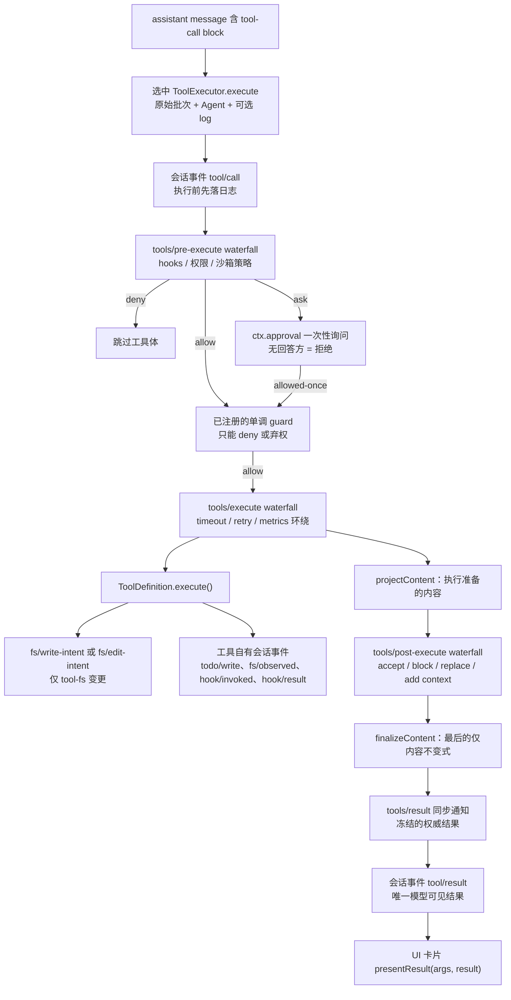

与外部插件相关的 API（`docs/subsystems/tools.zh.md:639-740`）：

| API | 语义 | 何时用 |
|---|---|---|
| `ctx.tools.register(definition, options)` | 注册全局或 agent 作用域工具；同层重名与保留名 `run_code` 会失败 | 新增工具 |
| `ctx.tools.restrict(filter)` | 为调用方作用域**收窄**全局工具集（`allow`/`deny`，多个 restrict 取交集） | 只能移除，不能新增 |
| `ctx.tools.guard(guard)` | 注册**单调**拒绝（只能 deny/弃权），在 pre-execute 与 approval 之后执行 | 安全护栏，不能被下游"翻案" |
| `ctx.tools.setExecutor(executor)` | 为调用方作用域提供执行器；无作用域贡献是部署默认 | 替换调度/PTC 语义 |
| `ctx.tools.schemas(scope, toolSet)` | 白名单投影为模型可见 schema（**执行/展示回调绝不泄漏**） | 自己组装请求时 |
| `ctx.tools.execute(input)` | 把原始批次交给最近作用域执行器 | 程序化调用、测试必须走这条 |

三条与外部插件强相关的性质：

1. **`ToolDefinition` 的宿主字段不会进模型**：`output`/`execute`/`projectContent`/`finalizeContent`/`timeoutMs`/`isConcurrencySafe`/`presentCall`/`presentResult` 全部被 `schemas()` 白名单过滤（`docs/subsystems/tools.zh.md:9`）。
2. **条件工具需要"步骤准入集合"**：0.2.1-rc.2 的破坏性变更之一就是"工具声明只来自步骤准入的注册：`system-prompt/assemble` 不再携带工具"（`docs/upgrade-guide/v0.2.1-rc.2/conditional-tools/guide.zh.md:3`）。这意味着任何试图从提示词组装处读工具清单的老插件会**静默拿到空集**。
3. **工具呈现（presentCall/presentResult）必须是纯函数**：UI 会在实时流与日志回放两种场景调用它，必须只依赖 `args` 与持久 result（`docs/subsystems/tools.zh.md:9` 的 JSDoc）。

#### 3.3.6 会话事件溯源

这是 DSH 最"数据库化"的一块，也是 composer-assist 这类"读历史做上下文"插件的关键底座。

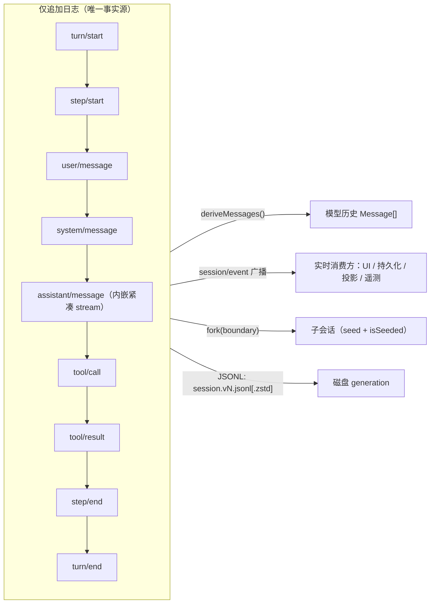

| 事实 | 内容 | 证据 |
|---|---|---|
| 事件词汇可扩展 | `SessionEventMap` 通过声明合并扩展；`compaction/*`、`hook/*` 就是这么加的 | `docs/subsystems/session.zh.md:9-12` |
| 模型可见即已记录 | 每个模型请求必须能从日志重建；新增模型可见输入**需要**新事件 | `docs/architecture.zh.md:132` |
| 派生历史 | `deriveMessages()` 缓存且冻结；`deriveEventMessage(event)` 暴露逐节点纯函数供外部重建器复用 | `docs/subsystems/session.zh.md:675-679` |
| 序列号连续 | `seq` 在 settlement 与交错事件间保持连续；所有 `event.data` 必须可 JSON 序列化，`Session.append` 在源头强制 | `docs/subsystems/session.zh.md:810-814` |
| fork | `fork(source, boundary?, childSessionId?)`；默认到最后一个事件，闭合开放尾部 | `docs/subsystems/session.zh.md:686-692` |
| 落盘格式 | v0 用 `session.jsonl[.zstd]`，v1+ 用 `session.vN.jsonl[.zstd]`；已提交 generation 不重命名/替换/删除 | `docs/architecture.zh.md:130` |
| 投影 seam | `ctx.sessionProjections`：注册单元增量折叠，`snapshot()` 取裁剪后的客户端视图 | `docs/architecture.zh.md:134` |

**红线**（来自随包技能实测，且与官方文档一致）：**不要用新的 `type` 追加会话事件**。`Session.append()` 写不出 `ignorable: true`，会让会话打不开。状态应从既有事件推导，或放进 storage 服务。这一条比"事件名写错"严重得多——写错事件名的插件只是自己失效，写错事件**格式**的插件会让用户的历史会话无法打开。

#### 3.3.7 沙箱的真实实现

用户文本这一条基本正确，需要的是**精度修正**。

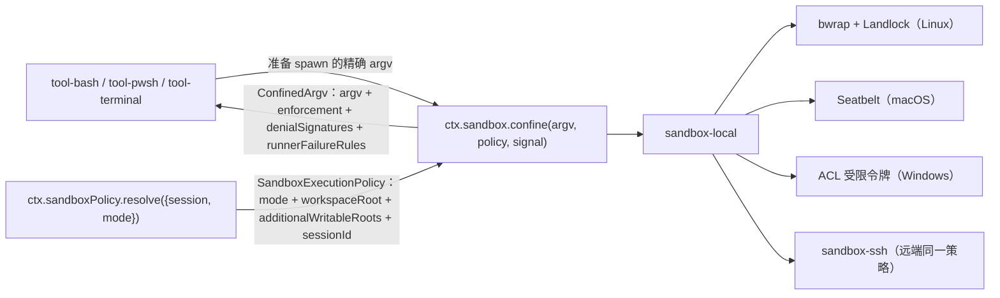

| 概念 | 真实语义 | 证据 |
|---|---|---|
| `SandboxMode` | 仅三种：`read-only` / `workspace-write` / `danger-full-access`；**只管文件效果**，网络与进程可见性不在词表内 | `docs/subsystems/sandbox.zh.md:11` |
| 只有受限模式进 provider | `danger-full-access` 的消费方直接 spawn 原始 argv，不调 `ctx.sandbox` | `docs/subsystems/sandbox.zh.md:19` |
| `enforcement` | `full` / `partial` 是**后端报告的事实**：旧 Landlock ABI、Windows ACL runner 的硬链接/读取不受限/AppContainer 边界会报 `partial` | `docs/subsystems/sandbox.zh.md:30` |
| `ConfinedArgv` | 除 argv 外携带 `denialSignatures`（bwrap 的 EROFS、Landlock 的 EACCES、Seatbelt 的 EPERM）与 `runnerFailureRules` | `docs/subsystems/sandbox.zh.md:141-146` |
| fail-closed | 无可用后端时 `SandboxUnavailableError`（`SANDBOX_UNAVAILABLE`）；"静默无隔离透传永远不合法" | `docs/subsystems/sandbox.zh.md:163` |
| 策略解析优先级 | 批准的显式 mode > 会话最后一条 `sandbox/mode` 事件 > 部署默认；会话 cwd 即 `workspace-write` 根 | `docs/subsystems/sandbox.zh.md`（`ctx.sandboxPolicy.resolve` 的 JSDoc） |
| bash 与 fs 不漂移 | 两者读同一个 `ctx.sandboxPolicy`，因此不会限制到不同根目录 | `docs/capability-seams.zh.md:716` |

**三个常见误解**：

- 沙箱不是"虚拟机的替代品"：它只约束**文件效果**，不承诺网络隔离。
- 沙箱不是全局开关：策略**逐调用**解析并携带，两个并发会话可以同时跑在不同模式下（`docs/subsystems/sandbox.zh.md` 第 88-105 行的 `SandboxPolicy` JSDoc："carried PER CALL, not fixed on the provider"）。
- 沙箱执行器不是工具的职责：工具把**即将 spawn 的 argv** 交给 seam，包装由提供方完成。

#### 3.3.8 Web 客户端：slot / 主题 / locale

这是 composer-assist 的"另一半"，也是外部插件最容易踩空的地方。

**启动与组装**

| 步骤 | 内容 | 证据 |
|---|---|---|
| 1 | 包在 `package.json` 声明 `dsh.client { platform: 'web', inject?, immediately? }`，并在 `exports["./client"]` 导出构建好的 bundle | `docs/subsystems/client-modules.zh.md:94` |
| 2 | Host 半边扫描 loader entry，组合 `WebBootGraph`，写入 `window.__DSH_BOOT__` | `docs/subsystems/web-client.zh.md:24` |
| 3 | 浏览器 module-loader 是 **lazy CommonJS 表**：加载 bundle 只注册 factory，materialize entry 时才 `require` | `docs/subsystems/web-client.zh.md:24` |
| 4 | Web boot kernel 创建模块系统、预取 `immediately` entry、挂载 vendored Cordis Loader，再创建每个 entry | `docs/subsystems/web-client.zh.md:26` |
| 5 | **Cordis 服务注入决定激活顺序**；module graph 顺序只决定同步 import 能否 materialize | `docs/subsystems/web-client.zh.md:26` |
| 6 | 全量 roster settled 后 `ui-renderer` 调用唯一一次 `ctx.slots.renderSlot('root', {})` | `docs/subsystems/slots.zh.md:23` |

**Slot 系统的四个维度**（`docs/subsystems/slots.zh.md:52-66`）

| 维度 | 取值 | 含义 |
|---|---|---|
| cardinality | `single` / `list` / `keyed` / `chain` | 单格取胜者 / 按 `id` 与 `order` 排序的列表 / owner 传 `entryKey` 的匹配 / `select(owner)` 选举 |
| scope | `root` / `session-maybe` / `session` | 一个 root store / 无 binding 也可渲染 / 必须可解析 Session binding |
| priority | 数值越小越先 | `single|list|keyed` 是遮蔽优先级；`chain` 是选举顺序 |
| props 来源 | owner props / `store` / `inject` factory / `locale` namespace / slot 级 inject face | `PropsRuntime` / `PropsStore` / `InjectFace` / `PropsLocale` / `PropsRenderSlots` |

**真实 slot 名（节选，来自官方当前层级图）**：`root`、`main[key=conversation]`、`main.conversation`、`conversation.header`、`conversation.session.header.actions`、`conversation.content`、`conversation.session`、`conversation.view`、`conversation.chat.text-interaction`、`conversation.chat.flow`、`conversation.chat.node`、`conversation.chat.user.content`、`conversation.chat.reasoning.body`、`tool.call.toolview`、`conversation.composer`、`conversation.composer.bar`、`conversation.input.attachments`、`conversation.input.permission`、`conversation.input.plan`、`conversation.input.model`、`conversation.input.overlay`、`conversation.composer.dock`、`conversation.input.left`、`conversation.input.right`、`conversation.input.dock`、`conversation.hero.*`（`docs/subsystems/slots.zh.md:124-195`）。

注册写法（官方示例，`docs/subsystems/slots.zh.md:42-49`）：

```tsx
export const inject = ['slots']
export function apply(ctx: Context): void {
  ctx.slots.inject('conversation.session.header.actions', () =>
    ctx.slots.register({ name: 'conversation.session.header.actions', id: 'review', order: 100 }, HeaderAction))
}
```

**Slot 的三条硬规则**

1. **只在"拥有并渲染该位置"的组件里声明 child slot**；其他包必须 `ctx.slots.inject()` 等待后 `ctx.slots.register()` 贡献（`docs/subsystems/slots.zh.md:203-210`）。
2. **注册与声明遵循 Cordis effect 生命周期**：销毁 entry 会移除贡献并递归折叠它声明的 child slot；owner 重新挂载时 `inject` 回调重跑（`docs/subsystems/slots.zh.md:25`）。
3. **组件绝不接收 `ctx`**：owner 已知的值走 owner props，私有数据走注册项 `inject`，共享可变视图状态走声明的 store（`docs/subsystems/slots.zh.md:85`、`:116`）。

**主题**

- `--dsw-*` 静态色阶、语义别名、排版、动效、渐变、阴影、滚动条与明暗偏好全部归 `ui-theme`；`ui-layout` 把解析后的主题快照应用到文档（`docs/web-styling.zh.md:9`）。
- 功能包**只准用语义别名** `--dsw-alias-*`（如 `--dsw-alias-border-*`、`--dsw-alias-link`），不得写颜色字面量、不得复制静态色板、不得自带主题选择器（`docs/web-styling.zh.md:18`、`:19`）。
- 高层级表面用 elevation token（`--dsw-elevation-panel` / `--dsw-elevation-prominent` / `--dsw-elevation-soft`），0.5px 发丝描边是第一层投影（`docs/web-styling.zh.md:26`）。
- 圆角尺度走 `--dsw-radius-*`（`docs/ui-radius.zh.md:32-33`）。

> 对 composer-assist 的意义：若它自定义了 `--dsh-composer-hint` 这类**自有变量**，那是包内局部约定，不属于主题契约；而它如果读宿主 DOM 的 `data-composer-*` 标记，那是**非契约事实**（D 级），升级随时可能静默失效。

**locale**

- 每个 UI 包自带 `locale/en.json`、`locale/zh.json`；`meta.title` / `meta.description` 是展示元数据。实测最小样本：`node_modules/@deepseek-ai/dsh-client-ui-theme/locale/en.json` 只有 `{"meta":{"title":"ui-theme"}}`。
- slot 注册项的 `locale` 选项声明 namespace，renderer 据此为组件生成 `t` 函数（`docs/subsystems/slots.zh.md:80`、`:104`）。
- 展示元数据有两条容易"静默失效"的坑（0.2.1 起）：① 包里有 `exports` 时必须显式导出 `"./package.json"` 与 `"./locale/*.json"`，否则图标与 locale 元数据丢失；② 子路径插件**不再读** `<pkg>/<sub>/package.json`，文案走 `<pkg>/<sub>/locale/*.json`、图标走导出的 `<pkg>/<sub>/icon`（`docs/upgrade-guide/v0.2.0-rc.2/subpath-plugin-display-manifest/guide.zh.md:3`）。
- 0.2.1-rc.2 的内置语言注册会与使用相同 id 的第三方语言包冲突（`docs/upgrade-guide/v0.2.1-rc.2/built-in-japanese/guide.zh.md:3`）。

#### 3.3.9 配置分层与 patch 覆盖语义

**五层叠加**（顺序即优先级，后写者胜）：


证据：`docs/architecture.zh.md:25`（"各层依次应用在空条目列表之上：profile 中有序的组合包、其 `cordis.patch.yml`、home patch，最后是 `--patch` overlay"）；`node_modules/@deepseek-ai/dsh-app-boot/README.zh.md:61`（"先应用逐 profile 的文件，再应用 home 级文件，因此后者优先级更高"）；`docs/cli-help.zh.md:43`（`--patch <path>` 是 "extra patch-list overlay applied after the ..."）。

**patch 的三条语义（每条都能让插件静默失效）**

| 语义 | 内容 | 后果 |
|---|---|---|
| 按 `id` 定位 | 一条 patch 按 id 定位某个条目并**替换其整个 config**，或 `insert` 新条目 | **不是深合并**：覆盖时必须重述该行需要的每个键 |
| 插入 | `insert:` 列表；行字段是 `id` + `name`（模块说明符，可为绝对路径/文件 URL/包标识符）+ `disabled` + `config` | 插入顺序不带加载语义（激活由服务可用性驱动） |
| 表达式 | `!!js` 表达式在条目激活后基于该插件上下文插值 `config`；`disabled` 每次挂载决策时插值 | 写错求值上下文会导致该行永不激活 |

证据：`node_modules/@deepseek-ai/dsh-base/cordis.patch.yml:1-14`（"A patch replaces the targeted row's whole `config` rather than merging into it" + "Row order carries no load semantics"）；`node_modules/@deepseek-ai/dsh-app-boot/README.zh.md:61`（`!!js` 插值、patch 条目不存在时输出 stderr 警告、空文件/仅注释文件会导致启动失败，需用 `[]` 禁用该层）。

**两个观测工具（升级/排障必用）**

| 命令 | 作用 | 注意 |
|---|---|---|
| `dsh --profile <name> --dump-config` | 打印组合后的条目列表，按注释分组标明每个源文件与 patch 层；未匹配任何行的 patch 会带层标签报出 | 被策略拒绝的插件行仍会出现在 dump 里（它报告的是"配置出的组合"） |
| `dsh --profile <name> --dump-config-schema` | 直接给出条目与补丁的 JSON Schema，不用挂载即可校验 patch 写法 | 会 import 每个组合模块读取 schema，**只对已信任插件的 profile 运行** |

证据：`docs/cli-help.zh.md:45-47`；`node_modules/@deepseek-ai/dsh-app-boot/README.zh.md:73`、`:79`、`:52`。

**真实 profile 长什么样**（本机 `~/.dsh/profiles/web/`，只读观察）：

```
profiles/web/
├── package.json        # 依赖（含 link:/file:/tgz 形式的树外插件）+ dsh.profile.bundles（8 项，有序）
├── cordis.patch.yml    # 用户 tweak 层：按 id 覆盖 config，例如给 llm-pi-ai 加 provider
├── cordis.yml          # 根配置
├── node_modules/       # pnpm 安装的树外插件
├── pnpm-lock.yaml
└── pnpm-workspace.yaml
```

其 `dsh.profile.bundles` 实际内容是：`@deepseek-ai/dsh-base` → `@deepseek-ai/dsh-web-app` → `@deepseek-ai/dsh-experimental-auto-review` → `@deepseek-ai/dsh-experimental-agent-team-profile` → `dsh-dream-skin` → `dsh-context` → `@deepseek-ai/dsh-experimental-inspector-profile` → `dsh-compress-codex`。**注意混编**：官方 bundle 与树外 bundle 在同一个有序列表里，优先级由位置决定——这是"关掉再打开会把 bundle 排到末尾从而改变优先级"的根源（`packages/boot/plugin-manager/README.zh.md:40`）。

**HMR**：启用 `dsh-hmr` 时监视 profile manifest 与两份用户 patch 文件并重组；未启用时改动要重启（`node_modules/@deepseek-ai/dsh-app-boot/README.zh.md:63`、`docs/architecture.zh.md:27`）。HMR 串行执行模块重载、文件监听与管理写入（`packages/boot/plugin-manager/README.zh.md:122`）。**"cordis.patch.yml 热插拔"成立**，但成立的前提是 HMR 行真的在跑；`yaml` 决定 HMR 是否启用，Headless/SDK/ACP 默认禁用（`docs/architecture.zh.md:27`）。

#### 3.3.10 插件依赖解析与版本兼容

**模块解析顺序**（决定 `import` 能不能找到包）

1. Host 在挂载 profile 条目前，从**安装依赖图 + 有序 bundle 依赖图**计算一份不可变的 **runtime resolution**，并安装进 Node 的 ESM 与 CommonJS resolver（`node_modules/@deepseek-ai/dsh-app-boot/README.zh.md:67`、`:138`）。
2. 不创建 fallback 链接；runtime resolution 条目占据 `$DSH_HOME/profiles/node_modules` 上各自的包名位置（同上 `:138`）。
3. 链接目录参与逐层 peer 查询：每个 `D/node_modules` 位置，`D/package.json` 的 peer 包名若在运行时表里就用运行时包（`:134`）。
4. 因此 **`@deepseek-ai/*` 共享宿主实例的包必须写进 `peerDependencies`（开发时同时进 `devDependencies`），绝不能进 `dependencies`**——否则模块解析向上找不到，`import` 抛 `ERR_MODULE_NOT_FOUND`，该行不加载，且很可能没有任何报错。这是随包技能 `dsh-plugin-construction` 的实测红线，机制与 `dsh-client-ui-theme/package.json` 的 `peerDependencies: { "@deepseek-ai/cordis": "~4.0.5" }` 一致。

**版本兼容：`engines.dsh` 优先，peer 次之，都没有则不设约束**

| 清单声明 | 判定规则 | 证据 |
|---|---|---|
| 有 `engines.dsh` | **只由该范围决定，忽略 `peerDependencies`** | `node_modules/@deepseek-ai/dsh-app-boot/README.zh.md:52` |
| 无 `engines.dsh`，有 DSH peer | `@deepseek-ai/dsh` 与每个 `@deepseek-ai/dsh-*` 的 peer 范围都必须匹配；`workspace:^/~/*` 指向同一运行时 | 同上 |
| 都没有 | 不施加版本约束 | 同上 |
| 畸形 | `engines` 不是对象，或 `engines.dsh` 不是字符串 → 视为畸形清单而拒绝；空/无效范围不兼容；`workspace:` 在 `engines.dsh` 里非法 | 同上 |

拒绝结果会列出未满足的要求，键为 `engines.dsh` 或 peer 包名（同上）。**这是 0.2.1 的破坏性变更**：0.2.0 时代 `engines.dsh` 只是声明，0.2.1 起强制且优先（`docs/upgrade-guide/v0.2.1-alpha.3/plugin-engines-dsh/guide.zh.md:3`）。

**豁免机制**：不兼容插件可在 profile 的 `compatibility.json` 里按精确 `package-name@version` → 精确 DSH 运行时版本列表授权；授权不随插件升级或 DSH 升级继承；授权要求 `acceptRisk: true`，且只应在警告用户后使用（`packages/boot/plugin-manager/README.zh.md:75-81`）。CLI：`dsh plugin --profile <p> version-exemptions` / `allow-version` / `revoke-version`（同文件 `:81`）。

**大局观察（本文实测）**：本机 305 个 `@deepseek-ai/*` 包中，**78 个声明 `dsh.client`、18 个声明 `dsh.bundle`、0 个声明 `engines.dsh`**。官方包靠"全部锁到同一版本 `0.2.1-rc.2`"保持一致，把 `engines.dsh` 留给第三方插件作者作为准入闸门——这解释了为什么第三方教程里"要不要写 engines.dsh"的答案会随版本翻转。

**0.2.1 周期内与插件作者最相关的破坏性变更（节选）**

| 变更 | 影响 | 证据 |
|---|---|---|
| `engines.dsh` 强制且压过 peer | 写错区间 = 把自己锁在某版本外 | `docs/upgrade-guide/v0.2.1-alpha.3/plugin-engines-dsh/guide.zh.md` |
| 工具执行模式移出 `dsh-tools` 配置，改为显式执行器插件 | 自定义执行器注册方式变化 | `docs/upgrade-guide/v0.2.1-rc.2/tool-executor-plugins/guide.zh.md:3` |
| 工具声明只来自步骤准入的注册；`system-prompt/assemble` 不再携带工具 | 从提示词组装处读工具清单的插件拿到空集 | `docs/upgrade-guide/v0.2.1-rc.2/conditional-tools/guide.zh.md:3` |
| 要求 Node.js ≥ 24.9，不再支持 22 | 构建与运行环境 | `docs/upgrade-guide/v0.2.1-rc.2/node-24/guide.zh.md:3` |
| 组合包列表与 profile 模板移到 `@deepseek-ai/dsh-official-bundles` | 直接 import `app-boot` 常量的代码失效 | `docs/upgrade-guide/v0.2.1-rc.2/official-bundle-lists/guide.zh.md:3` |
| 子路径插件不再读 `<sub>/package.json` 展示元数据 | 图标/locale 静默丢失 | `docs/upgrade-guide/v0.2.0-rc.2/subpath-plugin-display-manifest/guide.zh.md:3` |
| `dsh plugin` 只在转发给 pnpm 的参数**之前**读 `--profile` | 命令行位置写错会装错 profile | `docs/upgrade-guide/v0.2.1-alpha.1/plugin-option-placement/guide.zh.md:3` |
| `webserver` 渲染 index 需传入页面代表的 Peer；`webserver/index-inject` 会把 Peer 传给监听方 | 自定义 index 注入的签名变化 | `docs/upgrade-guide/v0.2.1-rc.2/webserver-index-peer/guide.zh.md:3` |
| Session 投影注册改为异步句柄；可调用注册结果与注册表级状态读取弃用 | 投影消费方要改 | `docs/upgrade-guide/v0.2.1-rc.2/session-projection-handles/guide.zh.md:3` |

> 方法论：**每次升级先读 `docs/upgrade-guide/<版本>/` 全目录**，再跑 `--dump-config` 与一次 UI 冒烟。这是官方自己定的流程（`docs/upgrade-guide/` 每个主题一篇 `guide.zh.md`），也是 composer-assist 这类无 CI 插件最大的风险敞口（Doc2 展开）。

#### 3.3.11 插件间协作的三条通道与包边界

插件之间**只有三条**正当协作通道。选错通道是"能跑但脆"的主要原因。

| 通道 | 适用 | 真实 API | 失败模式 |
|---|---|---|---|
| **服务注入** | 直接能力调用（读状态、发请求、注册后端） | `inject: ['llm']` → `ctx.llm.prepareCall(...)`；`ctx.get('x')` 用于可选读 | 未 inject 就访问 → 抛错并中止 apply |
| **事件** | 拦截与策略（观察、改写、拒绝） | `ctx.on('tools/pre-execute', listener)` / `agent/pre-step` / `llm/stream` | 漏 `next()` → 下游静默失效 |
| **Remote** | 跨进程（浏览器↔Host）能力 | Host 侧 `@Remote` / `@RemoteScope` 装饰服务方法；Client 侧 `ctx.remote.<ns>` 与 `agentCtx.remote.<ns>` | 未标记 `@Remote` 的方法根本不出现在生成的 Client 类型里 |

**Remote 的真实模型**（`docs/api-gateway.zh.md:9-20`、`docs/subsystems/typert.zh.md:5-15`）：

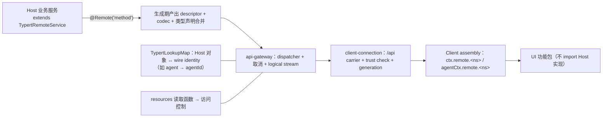

要点（每条都能在文档里找到出处）：

- 业务包通过 **`@Remote`（根 Host 上下文里的服务）** 或 **`@RemoteScope(key)`（先解析作用域 Context 再取服务）** 开放方法；**未标记的方法不会进入生成的 Client 类型或运行时贡献**（`docs/api-gateway.zh.md:9`）。
- 复杂 Host 对象不能直接跨 wire：必须用 `TypertLookupMap` 声明对象↔identity 映射，并在运行时向 `ctx.typert.lookups` 注册默认解析提供方；Gateway 在调用前把 `agentId` 解析成 `Agent`（`docs/api-gateway.zh.md:11`）。
- 内部 `$events` 逻辑流是 Connection generation 的来源；`ctx.remote.$on()` 把 **allowlist 内**的普通 event 交付给 root Client Context，把 **scoped waterfall** 交给已解析的 Session Context，监听器可返回结果、调 `next()` 或拒绝（`docs/subsystems/web-client.zh.md:34`）。

**包边界规则**（对 composer-assist 这类"一个包含两半"的插件尤其重要）：

1. 功能插件包之间**只能 `import type` 共享声明**，不得运行时 import 或转发另一个功能插件的值（`docs/subsystems/web-client.zh.md:91`）。
2. 跨包行为用**注入的 Cordis 服务**，跨包 UI 用 **Slots**（同上 `:91`）。
3. 共享运行时值必须有一个**职责收窄、无功能生命周期**的静态 owner（如 `client/store`、`ui-primitives`、浏览器安全 util 包）（`docs/subsystems/web-client.zh.md:93`）。
4. 功能包**不能只为绕过规则而添加 `dsh.client.external`**（同上 `:93`）。

#### 3.3.12 作用域（scope）与隔离：为什么"注册到哪"会改变行为

DSH 的注册有两层：**全局**与**带作用域**（恰好一个 scope key）。这不是实现细节，而是插件 API 的语义。

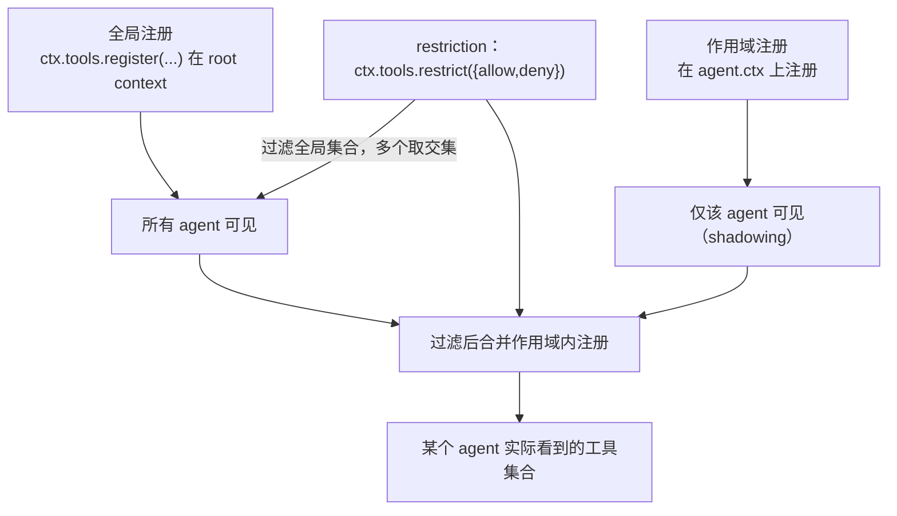

| 概念 | 定义 | 证据 |
|---|---|---|
| scope | 按 agent 划分的注册单位；只有两层，**扁平**，带作用域的注册不向下继承给 subagent | `docs/glossary.zh.md:13` |
| scope key | 不透明标识，按对象同一性比较；**一个活跃 agent 就是其自身 scope 的 key** | `docs/glossary.zh.md:14` |
| `agent.ctx` | agent 的带作用域上下文；注册既是 scope 可见性、生命周期也绑定该 scope | `docs/glossary.zh.md:15` |
| scoped dispatch | 关于某 agent 活动的事件用该 agent 的 carrier 分发；**注册表主体事件（"某工具被添加了"）不过滤** | `docs/glossary.zh.md:17` |
| shadowing | 最具体者胜出：带作用域注册仅在 scope 内替换同名全局项 | `docs/glossary.zh.md:18` |
| restriction | `tools.restrict` 为单 scope 过滤全局工具集；被滤掉的工具**既不出现在提示词里也拒绝执行**，与不存在无法区分 | `docs/glossary.zh.md:19` |
| setup window | `CreateAgentOptions.setup`：scope 与 agent 已存在，但会话未发布、`agent/created` 未触发；**setup 只做注册，不驱动 agent** | `docs/glossary.zh.md:20` |
| lineage | 以数据携带的父子关系（`parentSession`、`delegationDepth`、`subagentDepth`），**从不影响可见性** | `docs/glossary.zh.md:21` |

**隔离（isolate realm）**：需要"某个会话拥有不同能力集合"时，官方答案是组装 agent preset，且"其中的服务行需要 `isolate` realm"（`docs/architecture.zh.md:154`）。`ctx.agentPresets` 会"立即挂载 YAML 声明的 preset 版本，把 Agent 与冷读取绑定到作用域内的贡献，并保留被替换的版本直到最后一个使用者释放它"（`docs/capability-seams.zh.md:700`）。

**给插件作者的三条推论**（⚠️ 本文推导）：

1. 若你的注册只应对某个会话生效，**注册到 `agent.ctx`**，不要注册到根上下文然后自己过滤。
2. 若你希望"全局默认 + 个别会话覆盖"，用 shadowing 语义（同名注册），而不是自己维护一张例外表。
3. 被 `restrict` 掉的工具**看起来像不存在**——如果你在 UI 上显示"工具不可用"，不要试图通过 `ctx.tools.get()` 区分"被禁"与"没有"，两者都返回 `undefined`（`docs/subsystems/tools.zh.md:651` 的 `get` 契约）。

#### 3.3.13 执行器插件与 PTC（0.2.1 的重要结构变化）

工具执行不再是 `dsh-tools` 的一个配置项，而是**显式的执行器插件**。这是 0.2.1 周期内对插件作者影响最直接的结构变化之一。

| 事实 | 内容 | 证据 |
|---|---|---|
| `dsh-tools` 保留什么 | 工具注册与**执行器选择**；加载时拒绝已移除的 `mode`、`maxParallelSubCalls` 配置字段 | `docs/upgrade-guide/v0.2.1-rc.2/tool-executor-plugins/guide.zh.md:8` |
| 必需插件 | 原生执行需 `dsh-tool-executor-native`，PTC 执行需 `dsh-tool-executor-ptc`；内置 profile 已挂载，**自定义组合必须自行添加** | 同上 `:8` |
| 启动必需 | 启用的 `tool-executor-native`/`tool-executor-ptc` 属于启动必需项；无效执行器配置会终止启动 | 同上 `:8` |
| PTC 依赖 | 需要兼容的 `ctx.ptcRuntime` 提供方；执行器声明它为必需注入，缺运行时会阻止启动 | 同上 `:12` |
| 并发上限 | `agent-loop.maxParallelToolCalls` 默认 `10`；循环向每个批次传入当前上限，**实时修改从下一个批次生效** | 同上 `:12` |
| 自定义执行器 | 实现 `describe` 与 `execute`；程序调用方传 `calls`/`signal`/可选 `agent` 与 `log:{turn,step}`；不属于已提交模型步骤的调用应**省略 `log`** | 同上 `:14` |
| 管线复用 | 从 `@deepseek-ai/dsh-tools/pipeline` 导入 `ToolExecutionPipeline` 与 `executeToolBatch`；自定义调度器直接调 `prepare`/`dispatch`/`complete` | 同上 `:18` |
| 环境变量 | Web/headless/SDK 不再读 `DSH_TOOLS_MODE`，统一继承 base 的原生执行 | 同上 `:8` |

**`ToolExecutor` 的两个方法**（`docs/subsystems/tools.zh.md:224-307`）：

```ts
interface ToolExecutor {
  readonly sections?: readonly ToolPromptSection[]   // 执行器自有的提示词段，随 effect 注册/释放
  describe(tools: readonly ToolDefinition[]): ToolModelInput   // schemas + knownNames
  execute(input: ToolBatchInput): Promise<ToolBatchResult>     // 完整批次的结算
}
```

**PTC 的执行语义**（`docs/tool-execution-pipeline.zh.md:66`）：保留的 `run_code` 传输与其**序列化子调用**都进入同一管线；子调用携带父级 token、记录 `tool/ptc-dispatch`、把拒绝呈现为有约束力的驳回，并省略 `additionalContexts` 以保持调用与结果相邻。

**对插件作者的含义**：

- 想让工具在 PTC 模式下可用，**不需要**改工具定义；但必须确保部署挂载了 PTC 执行器与 `ctx.ptcRuntime`。
- 想改变"如何调度/呈现"，做**执行器插件**而不是改 `dsh-tools`（0.2.x 起前者是唯一被支持的路径）。
- 想给工具加超时，用 `tools/execute` 的环绕监听器（官方 `tool-call-timeout-policy` 就是 `tools/execute` wrapper，`docs/subsystems/tools.zh.md:9` 的 `timeoutMs` JSDoc）。

#### 3.3.14 六类 seam 的注册范式对照

同样是"可替换能力"，注册方式却分两大类：**抽象类继承 + 服务提供**，与**命名注册表 + register()**。搞错会导致插件"编译过、跑不起"。

| seam | 注册/提供方式 | 官方提供方 | 消费方 | 生命周期要点 |
|---|---|---|---|---|
| `ctx.llm` | 继承 `LlmAdapter` 实现 `stream()`，再 `registerAdapter(providers, adapter)`（全有或全无） | `llm-deepseek`、`llm-pi-ai`、`llm-replay` | `agent-loop`、`compaction-basic` | 重复 provider 路由原子失败；disposer 随 fiber |
| `ctx.tools` | `register(definition)` + `setExecutor(executor)`（执行器可作用域化） | 各 `tool-*` 包 / `tool-executor-*` | `agent-loop` | 未作用域的执行器贡献是**部署默认**；卸载后该选择不可用直到被替换 |
| `ctx.sandbox` | 抽象 seam：实现 `confine(argv, policy, signal)` 并注册提供方 | `sandbox-local`、`sandbox-ssh` | `bash-sandbox`、`terminal-bash` | 无后端 → fail closed（`SANDBOX_UNAVAILABLE`） |
| `ctx.storage` | `register(name, backend)`，**多后端并列**（`json`/`sqlite`），路由由领域层配置决定 | `storage-json`、`storage-sqlite` | `storage-domain` | dispose 只注销名称；后端由拥有者自行关闭 |
| `ctx.subagents` | 注册后端：`startActivation` 统一 API，`prepareContinuable` 选本地创建、`start` 选外部执行 | `subagent-spawn-in-process`、`subagent-fork-in-process`、`subagent-acp`、`subagent-codex`、`subagent-claude-code`、`subagent-dsh-sdk` | `tool-subagent`、`tool-subagent-control`、`tool-ralph` | 能力标记在准入阶段校验请求选项；`depthLimit` 控制 `maxDepth` |
| `ctx.directoryPicker` | **带判别标记的交互能力**：native 后端弹系统选择器，browse 后端提供列表/创建原语 | `host-directory-picker-native`、`host-directory-picker-browse` | `api-workspace-controller` | 双端后端通过浏览器侧 slot 填充 UI，**不走协议发布** |

证据：`docs/capability-seams.zh.md:656`（llm）、`:697`（tools）、`:715`（sandbox）、`:687`（storage）、`:722`（subagents）、`:730`（directoryPicker）；`docs/subsystems/storage.zh.md:5`（`register(name, backend)` 与 `storageBackendServiceKey(name)`）；`docs/subsystems/subagent.zh.md:5-9`（activation API）。

**共同的"seam 三件套"模板**（官方定义，`docs/glossary.zh.md:9`）：

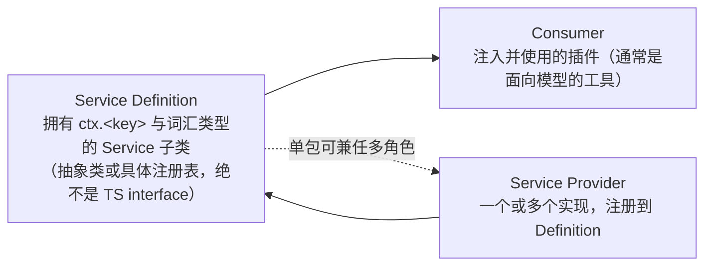

一个包可以同时承担多个角色：`dsh-user-approval` 就在同一个包里同时是 approval seam 的 Definition 与具体实现（`docs/glossary.zh.md:9`）。这条提醒很实用——**不要因为"官方分了三个包"就以为必须拆三个包**。

#### 3.3.15 HMR、重载失败策略与"必需行"

插件的"热更新"不是魔法，是 `recomposeProfile` 的一次事务。

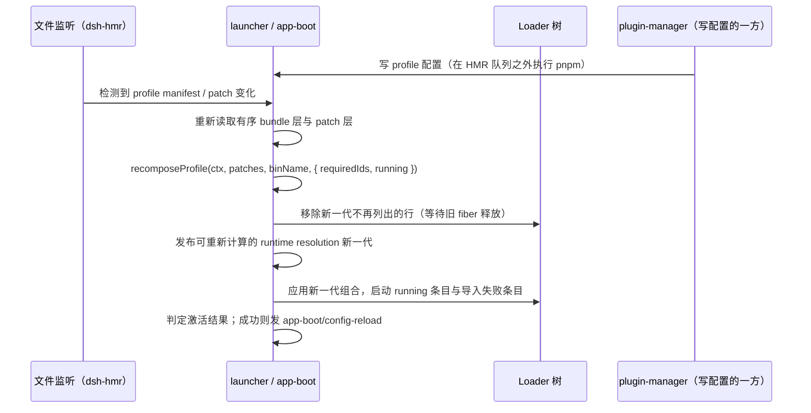

| 机制 | 规则 | 证据 |
|---|---|---|
| 重载成功判定 | 新增未激活条目、配置或 fiber 变化、诊断变化都会使重载失败；被移除的 fiber 仍须释放完成 | `node_modules/@deepseek-ai/dsh-app-boot/README.zh.md:94` |
| 失败回滚 | 新一代组合应用**之前**的失败会把移除的行放回原位置并重启，也重启 `running` 条目 | 同上 `:94` |
| `package-moved` | runtime resolution 拒绝发布时，停掉并重启"该发布将丢弃的行"，组合不变，报告 `restart-required` + `package-moved` | 同上 `:94`；`packages/boot/plugin-manager/README.zh.md:124` |
| 必需行 | 全局 `requiredIds`：`agent-loop`、`webserver`、`web-runtime`、`modules`、`connection`、`headless-runner`、`acp`、`sdk-jsonrpc-server`；失败则整体拆除退出 | `node_modules/@deepseek-ai/dsh-app-boot/README.zh.md:43` |
| 跳过组合包 | 组合包解析/manifest 读取/patch 加载失败 → **跳过该组合包**、不改选择状态、列入 `skippedBundles`，每次启动输出一次 | 同上 `:50` |
| 组合包版本不兼容 | 与"不可读"同样跳过并列入 `skippedBundles` | 同上 `:52` |
| 无 HMR | 启动期组合不可删；包操作报告 `restart-required`，`restartReason` ∈ `no-hmr` / `package-moved` / HMR 待处理原因 | `packages/boot/plugin-manager/README.zh.md:124` |
| 事件 | 成功重载在生命周期结束且诊断通过后发 `app-boot/config-reload`（不携带 diff 或解析后的配置） | `node_modules/@deepseek-ai/dsh-app-boot/README.zh.md:94`；`docs/event-producer-consumer.zh.md:31` |

**两个只在特定命令下可见的失败**（最坑人的两条）：

- `patch: entry "x" not found`——**只在 `--dump-config` 打印**，普通启动与 `--help` 冒烟看不到（`node_modules/@deepseek-ai/dsh-app-boot/README.zh.md:61`；随包技能实测）。
- 空 patch 文件或仅含注释 → **启动失败**，要禁用该层必须写 `[]`（同 `:61`）。

#### 3.3.16 安装与验证的四级阶梯

外部插件从"装进去"到"确认生效"，官方与实测共同指向四级验证。跳过任何一级都会留下盲区。

| 级 | 动作 | 能看到什么 | 看不到什么 | 证据 |
|---|---|---|---|---|
| 0 | `dsh plugin --profile <name> add <spec>` | 依赖安装、`dsh.profile.bundles` 对齐 | 插件是否真的激活 | `docs/cli-help.zh.md:29`、`:59`；`packages/boot/plugin-manager/README.zh.md:40` |
| 1 | `dsh --profile <name> --dump-config` | 组合后的行与来源层、未匹配的 patch、被拒行仍出现 | 运行期错误、UI 是否渲染 | `docs/cli-help.zh.md:45` |
| 2 | `dsh --profile <name> --dump-config-schema` | 条目/补丁的 JSON Schema，可离线校验 patch 写法 | 同上；且会 import 组合模块（只对已信任插件跑） | `docs/cli-help.zh.md:46`；`node_modules/@deepseek-ai/dsh-app-boot/README.zh.md:52` |
| 3 | `dsh --profile <name> --patch <overlay.yml> --help`（秒级冒烟） | Host 半边 `apply` 真执行、effect 注册与释放打印 | UI 半边；`patch: entry not found` | 随包技能实测；`docs/cli-help.zh.md:43` |
| 4 | 真实开页面、点一遍功能 | UI slot 是否渲染、locale/icon、交互 | 深层语义（需日志） | `docs/subsystems/web-client.zh.md:22-26` |

**安装阶段的三条纪律**（0.2.1 起）：

1. `--profile` 必须写在**转发给 pnpm 的参数之前**；写错位置会装进别的 profile（`docs/upgrade-guide/v0.2.1-alpha.1/plugin-option-placement/guide.zh.md:3`）。
2. 相对路径（`.`, `../plugin`, `file:`, `link:`）**锚定在你执行命令的目录**，所以在插件仓库里 `add .` 装的就是当前 checkout（随包技能；`packages/boot/plugin-manager/README.zh.md:50` 说明 `file:`/`link:` 按 profile 目录解析为绝对路径）。
3. **不要手写 profile 的 `package.json` / `cordis.patch.yml`，也不要在 profile 目录里跑 pnpm**——包操作与 manifest 写入共用 profile 写锁，手写会绕过它（`packages/boot/plugin-manager/README.zh.md:122`）。

#### 3.3.17 静默失效模式矩阵（排障用）

"装了没反应"在 DSH 里有一打以上不同根因。把这张表当检查清单用，比盲猜快得多。

| # | 症状 | 机制 | 定位手段 | 依据 |
|---|---|---|---|---|
| S1 | 行在配置里但完全不生效 | 插件 import 失败（缺 peer / 包名写错），该行不加载 | `--dump-config` 看行在不在；启动日志找 `ERR_MODULE_NOT_FOUND` | `node_modules/@deepseek-ai/dsh-app-boot/README.zh.md:67`；随包技能红线 |
| S2 | apply 半途停止、后续注册全无 | 访问了未在 `inject` 声明的服务，属性代理抛 `cannot get property ... without inject` | 给 `apply` 加日志；核对 `inject` 列表 | `docs/cordis-api/context.zh.md:158`；随包技能实测 |
| S3 | 某个策略突然不生效 | waterfall 监听器漏 `next()`，把下游吞掉 | 在监听器首行打点；检查是否无条件 `return` | `docs/cordis-primer.zh.md:35-39` |
| S4 | 覆盖配置没起作用 | 上游删了该行，override 被跳过 | `--dump-config` 找 `patch: entry "x" not found` | `node_modules/@deepseek-ai/dsh-app-boot/README.zh.md:61` |
| S5 | 配置只生效一半 | 期待深合并，实际是**整 config 替换** | 对照被覆盖行的完整 config 逐键检查 | `node_modules/@deepseek-ai/dsh-base/cordis.patch.yml:1-14` |
| S6 | UI 那一块不出现 | 未声明 child slot / keyed cell 已有 occupant / slot 名拼错 | `cordis_inspect what:"client"` 查实时树与精确 key | `docs/subsystems/slots.zh.md:21`、`:199` |
| S7 | 插件卡片没图标/没文案 | 有 `exports` 但没导出 `./package.json`、`./locale/*.json`、`./icon` | 断点看 `ERR_PACKAGE_PATH_NOT_EXPORTED`；核对 exports | 随包技能；`docs/upgrade-guide/v0.2.0-rc.2/subpath-plugin-display-manifest/guide.zh.md:3` |
| S8 | 安装被拒 | `engines.dsh` 范围不匹配（它压过 peer） | 错误记录里 `requirements` 键名 | `node_modules/@deepseek-ai/dsh-app-boot/README.zh.md:52` |
| S9 | 启动直接失败 | patch 文件为空/仅注释；或必需行缺失 | 补齐 `[]` 或修复必需行 | 同上 `:61`、`:43` |
| S10 | 改配置不生效、必须重启 | 该 profile 的 HMR 行被禁用或不存在 | 看 patch 里 `hmr` 行的 `disabled` | `docs/architecture.zh.md:27`；`packages/boot/plugin-manager/README.zh.md:124` |
| S11 | 会话打不开 | 私自 `Session.append()` 了新 `type` | 检查新增事件是否带 `ignorable` 语义 | 随包技能红线；`docs/subsystems/session.zh.md:810-814` |
| S12 | 条件工具神秘消失 | 0.2.1 起工具声明只来自步骤准入集合，`system-prompt/assemble` 不再携带工具 | 核对 `toolSet` 是否传入；读 conditional-tools 指南 | `docs/upgrade-guide/v0.2.1-rc.2/conditional-tools/guide.zh.md:3` |
| S13 | Client 半边完全没加载 | `dsh.client` 缺 `platform:'web'`、缺 `exports["./client"]`、或 `inject` 的包未激活 | 看 Host 侧 `__DSH_BOOT__` 图里有没有该 entry | `docs/subsystems/client-modules.zh.md:94` |

#### 3.3.18 插件包清单字段全解

把前面所有"漏了会怎样"集中到一张表（字段语义以 0.2.1-rc.2 为准）：

| 字段 | 必需性 | 作用 | 漏了/写错的后果 | 证据 |
|---|---|---|---|---|
| `name` / `version` | 必需 | 行 id 之外的身份；bundle 依赖解析 | 无法安装 | npm 语义 |
| `type: "module"` | 对 ESM 插件必需 | 决定 `import` 语义 | 加载失败 | `dsh-client-ui-theme/package.json` |
| `main` / `exports["."]` | Host 插件必需 | Loader 的模块入口 | 行导入失败 | 同上 |
| `exports["./client"]` | Client 插件必需 | 浏览器 bundle 入口 | UI 半边不加载（静默） | `docs/subsystems/client-modules.zh.md:94` |
| `exports["./package.json"]` | **有 exports 时必需** | 让展示元数据解析能读到清单 | 图标/locale 静默丢失 | 随包技能；0.2.1 规则 |
| `exports["./locale/*.json"]` | **有 exports 时必需** | locale 文案与 `meta` | 同上 | 同上 |
| `exports["./icon"]` 或顶层 `icon` | 推荐 | 插件卡片图标（≤256 KiB，SVG/PNG/JPEG/WebP；顶层字段优先） | 卡片无图标 | 随包技能；0.2.1 起两种写法都支持 |
| `dsh.bundle.patch` | bundle 必需 | 指向 patch 文件或有序文件列表 | 不会被当作组合包 | `node_modules/@deepseek-ai/dsh-base/package.json` |
| `dsh.client.platform` | Client 必需 | 目前为 `web` | 不进浏览器图 | `docs/subsystems/client-modules.zh.md:94` |
| `dsh.client.inject` | 推荐 | 声明包级依赖边（与 Cordis inject 是两条边，但共用同一份包名） | 模块工厂到达顺序可能不满足 | `docs/subsystems/client-modules.zh.md:11-38` |
| `dsh.client.immediately` | 可选 | 第一阶段预取 | 首屏更慢 | 同上 |
| `dsh.profile.bundles` | **仅 profile** | 有序组合包列表 | 不是 profile | `~/.dsh/profiles/web/package.json` |
| `peerDependencies`（`@deepseek-ai/*`） | **第三方插件必需** | 声明共享宿主实例的包 | `ERR_MODULE_NOT_FOUND`，该行不加载 | 随包技能红线；`dsh-client-ui-theme/package.json` |
| `devDependencies` | 开发期必需 | 让本仓库能编译/测试 | 开发期解析失败 | 同上 |
| `engines.dsh` | 发布时建议 | 声明兼容的 DSH 范围；**一旦存在即单独决定兼容性并忽略 peer** | 写错=把自己锁在某版本外 | `node_modules/@deepseek-ai/dsh-app-boot/README.zh.md:52` |
| `files` | 推荐 | 控制发布内容 | 漏发 `cordis.patch.yml`/`locale` 会静默失效 | `dsh-base/package.json`、`dsh-composer-assist/package.json` |
| `locale/*.json` 的 `meta.title/description` | 推荐 | 插件页展示文案；`meta.detail` 是详情文档来源 | 卡片只有包名 | 随包技能；`packages/boot/plugin-manager/README.zh.md:106` |

#### 3.3.19 扩展点选型：先用最弱够用的机制

同一个需求往往有三四种实现路径，强度从"只能移除"到"整段替换"递增。**强度越高，越容易在升级时坏掉**。

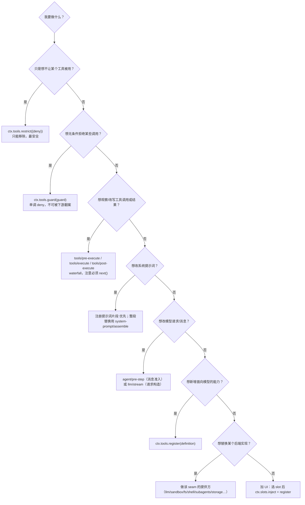

| 机制 | 能做什么 | 能否撤销 | 主要风险 |
|---|---|---|---|
| `ctx.tools.restrict` | 为单 scope 收窄全局工具集 | 是（返回 disposer） | 被滤掉的工具与"不存在"无法区分 |
| `ctx.tools.guard` | 单调拒绝（只能 deny/弃权） | 是 | 顺序在 pre-execute 与 approval 之后；不能在更早处生效 |
| `tools/*` waterfall | 改写/阻断/追加上下文/替换结果 | 是 | 漏 `next()` 吞掉下游；抛错会被规范化成 `isError` |
| `system-prompt/assemble` | 整段替换提示词组装 | 是 | 强度最高；注意 0.2.1 起它**不再携带工具** |
| `agent/pre-step` | 准入/改写/拒绝已认领消息 | 是 | 决定 `startsRequestSeries`，包装时必须保留 |
| `llm/stream` | 请求发出前短路或改写一次性请求 | 是 | 适配器查找发生在终端 continuation，改写要保证仍可达 |
| `ctx.tools.register` | 新增工具 | 是 | 条件工具必须走步骤准入（见 S12） |
| seam provider | 替换后端 | 是（卸载即撤） | 需实现完整契约；fail-closed 语义要遵守 |
| `ctx.slots.register` | 新增 UI | 是（effect 生命周期） | slot key/owner 语义；D 级 DOM 依赖 |

#### 3.3.20 生命周期与所有权自检清单

写完一个插件后，逐条打勾。这张表把"能跑"与"升级后还能跑"区分开。

| # | 检查项 | 错误做法 | 正确做法 | 依据 |
|---|---|---|---|---|
| C1 | `inject` 是否覆盖所有 `ctx.<service>` 访问 | 直接 `ctx.llm` 但没声明 | `export const inject = ['llm']` | `docs/cordis-api/context.zh.md:158` |
| C2 | 所有注册是否有 disposer 且被持有 | `ctx.tools.register(...)` 丢弃返回值 | `ctx.effect(() => ctx.tools.register(...))` | `docs/cordis-primer.zh.md:13` |
| C3 | 裸资源是否放进 `ctx.effect` | 自己 `setInterval` 不清理 | `ctx.effect(() => { const t = setInterval(); return () => clearInterval(t) })` | `docs/cordis-api/fiber.zh.md:10` |
| C4 | waterfall 是否委托 | `ctx.on('tools/pre-execute', () => {})` | `async (exec, next) => { /* 观察 */ return next() }` | `docs/cordis-primer.zh.md:35-39` |
| C5 | 注册的作用域是否正确 | 全局注册再自己过滤 agent | 需要按会话生效就注册到 `agent.ctx` | `docs/glossary.zh.md:15` |
| C6 | 是否假设了行顺序 | "我排在 base 后面所以先初始化" | 依赖 `inject`，不要依赖 YAML 顺序 | `node_modules/@deepseek-ai/dsh-base/cordis.patch.yml:1-14` |
| C7 | override 是否重述完整 config | 只写想改的键 | 整段重述该行所需的所有键 | 同上 |
| C8 | 是否读了不该读的内部字段 | 直接读 `ctx.systemPrompt` 私有属性 | 用注册 API 或事件 | `docs/architecture.zh.md:146-172` |
| C9 | UI 是否有降级路径 | 硬依赖 `data-composer-*` 标记 | 找不到标记时静默降级，不抛错 | `docs/web-styling.zh.md:18`（只承诺 token 与组件规则） |
| C10 | 会话事件是否只用现有 type | 新造 type 追加 | 从既有事件推导或放 storage | `docs/subsystems/session.zh.md:810-814` |
| C11 | 展示元数据是否齐全 | 只写代码不写 locale/icon | `locale/*.json` + `exports` 齐备 | `docs/subsystems/client-modules.zh.md:94` |
| C12 | 版本兼容是否声明 | 什么都不写 | 第三方包写 `peerDependencies`，发布包考虑 `engines.dsh` | `node_modules/@deepseek-ai/dsh-app-boot/README.zh.md:52` |

#### 3.3.21 插件作者 FAQ（八问）

| # | 问题 | 答案 | 证据 |
|---|---|---|---|
| F1 | 我能自己注册一个 HTTP 路由，不走 Remote 吗？ | 能：`ctx.webServer` 是"具名路由注册表 + index 转换 tap + 静态 dist 回退"，功能自有的下载**应当**注册精确 Fetch 路由。但认证与 Trust 栅栏在 Connection 侧，自建路由要自己负责准入 | `docs/capability-seams.zh.md:731`；`docs/subsystems/web-client.zh.md:32` |
| F2 | `apply` 里可以 `await` 长时间初始化吗？ | 不建议（⚠️ 推断）：`apply` 是注册时机；官方对同类时机（setup window）明确规定"只做注册，从不驱动 agent"。长期工作交给 jobs/storage 等服务 | `docs/glossary.zh.md:20` |
| F3 | 为什么插件在 web profile 好了、headless 没好？ | profile 是**独立组装**：不同 profile 有不同的 bundle 列表与 patch；`headless`/`sdk`/`acp` 还默认禁用 HMR | `docs/architecture.zh.md:17`、`:27` |
| F4 | 能直接读 `session.vN.jsonl` 做分析吗？ | 不应作为契约：消费方只了解"当前逻辑格式"，历史由迁移链在 open 时归一化；跨版本读文件会静默错 | `docs/architecture.zh.md:130`；`docs/subsystems/session.zh.md:810` |
| F5 | 监听器顺序可控吗？ | 按注册顺序；waterfall 需要抢在最前时用 `prepend: true`；行顺序**不**决定激活顺序 | `docs/cordis-primer.zh.md:37`；`dsh-base/cordis.patch.yml` |
| F6 | 怎么只对某个会话生效？ | 用该 agent 的 `agent.ctx` 注册；要"不同能力集合"则组装 agent preset，服务行需 `isolate` realm | `docs/glossary.zh.md:15`；`docs/architecture.zh.md:154` |
| F7 | 我该把 UI 挂到哪个 slot？ | 先读当前 slot 层级图，找"确实由某个 owner 声明并渲染"的位置；composer 区域常用 `conversation.composer.*` 与 `conversation.input.*` | `docs/subsystems/slots.zh.md:124-195` |
| F8 | 版本兼容到底写 `engines.dsh` 还是 peer？ | 有 `engines.dsh` 就只由它决定（并忽略 peer）；没有才回退 peer；两者都无则不设约束。发布面广就用 `engines.dsh`，本地开发用 peer | `node_modules/@deepseek-ai/dsh-app-boot/README.zh.md:52` |

#### 3.3.22 可观测性：插件坏掉时该看哪里

"静默失效"之所以普遍，是因为**多数失败不在默认输出里**。DSH 提供了五类观测面，按成本从低到高排列：

| 观测面 | 你能看到 | 怎么看 | 证据 |
|---|---|---|---|
| 启动诊断 | 未处理 rejection / 未捕获异常会带标签 `util.inspect` 写 stderr；启用但失败的插件给带标签警告；必需行失败整体退出 | 直接看启动 stderr | `node_modules/@deepseek-ai/dsh-app-boot/README.zh.md:43` |
| 配置投影 | 组合后的行、每行来源层、未被匹配的 patch、被拒但仍出现的行 | `dsh --profile <p> --dump-config` | `docs/cli-help.zh.md:45`；`node_modules/@deepseek-ai/dsh-app-boot/README.zh.md:73` |
| Schema 校验 | 条目与补丁的 JSON Schema（不挂载即可校验写法） | `dsh --profile <p> --dump-config-schema` | `docs/cli-help.zh.md:46`；`node_modules/@deepseek-ai/dsh-app-boot/README.zh.md:79` |
| Cordis 实时树 | 跨 realm 的 Host/Client observation 与 Cordis tree query；Client slot 实时树与精确 key | `ctx.inspector`；`cordis_inspect what:"client"` | `docs/capability-seams.zh.md:726`、`:737`、`:738`；`docs/subsystems/slots.zh.md:199` |
| 包操作诊断 | 安装日志与状态流（`installing`/`cancelling`/`applying`/`restoring`）、诊断日志目录 `.plugin-manager/logs` | `plugin-manager/install-log`、`plugin-manager/install-state` 事件；读日志文件 | `docs/event-producer-consumer.zh.md:61-63`；`packages/boot/plugin-manager/README.zh.md:56`、`:173` |

**排障顺序建议**（⚠️ 本文总结，非官方规定）：

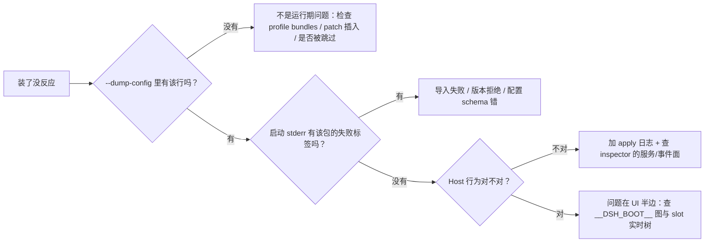

#### 3.3.23 演进与废弃：插件作者如何跟上 0.2.x

DSH 对每个破坏性变更都保有一篇升级指南，结构高度一致：**变更 → 迁移（分步）→ 后果**。例：挂载工具执行器那篇先讲"`dsh-tools` 保留什么、拒绝什么、必需哪些插件"，再给 7 步迁移清单（`docs/upgrade-guide/v0.2.1-rc.2/tool-executor-plugins/guide.zh.md:8-30`）。

| 信号类型 | 具体例子 | 对插件作者的含义 |
|---|---|---|
| 明确标"已弃用" | `agent/request` hook（`docs/architecture.zh.md:116`）；`dsh-agent-tool-presentation` 选择器"仍受支持但已弃用"（`tool-executor-plugins/guide.zh.md:8`） | 现在能跑，下个小版本可能移除；应尽快迁到替代事件/插件 |
| 注册语义变更 | Session 投影注册异步解析为句柄；"可调用的注册结果与注册表级状态读取已弃用"（`docs/upgrade-guide/v0.2.1-rc.2/session-projection-handles/guide.zh.md:3`） | 依赖返回值的代码会编译过但行为变 |
| 字段/入口搬迁 | 组合包列表与 profile 模板移到 `@deepseek-ai/dsh-official-bundles`（`official-bundle-lists/guide.zh.md:3`） | 直接 import 老位置会失败 |
| 清单规则收紧 | `engines.dsh` 从声明变强制且优先（`plugin-engines-dsh/guide.zh.md:3`） | 老包可能突然装不上 |
| 提示词/工具装配变化 | 工具声明只来自步骤准入（`conditional-tools/guide.zh.md:3`） | 从 `system-prompt/assemble` 读工具的代码静默拿空集 |
| 运行时基线提升 | Node ≥ 24.9（`node-24/guide.zh.md:3`） | CI 镜像与 `engines.node` 要同步 |

**订阅式升级流程（建议写进插件仓库的 CONTRIBUTING）**：

1. 升级 DSH 后先读 `docs/upgrade-guide/<新版本>/` 全目录（每篇 3~5 分钟）。
2. `dsh --profile <p> --dump-config` 一次，专找 `patch: entry "x" not found`。
3. `--dump-config-schema` 校验 patch 写法（0.2.1 新增，无需挂载）。
4. 装进测试 profile，跑一次真实 UI 路径。
5. 若被迫使用不兼容插件，走 `compatibility.json` 豁免并记录理由（授权不随升级继承）。

#### 3.3.24 可逆性验证：卸载之后必须"不留痕"

DSH 把可逆副作用当作核心哲学（`docs/architecture.zh.md:11`），因此"能卸载干净"是插件质量的一部分，而不是加分项。对第三方插件，最实用的验证是**在同一进程里禁用再启用**（HMR 开启时可行），观察以下几件事是否都恢复原状。

| # | 观察点 | 干净的表现 | 不干净的后果 | 依据 |
|---|---|---|---|---|
| R1 | 工具表 | 禁用后 `ctx.tools.schemas()` 不再含该工具；再启用后按注册顺序回到原位 | 残留工具名会污染提示词与工具调用 | `docs/subsystems/tools.zh.md:651` |
| R2 | 监听器 | 禁用后事件不再触发该插件的回调 | 旧监听器仍在跑会导致重复动作/重复模型调用 | `docs/cordis-primer.zh.md:13` |
| R3 | 服务槽位 | 自己 `provide` 的服务在卸载后不可用（消费方等待或被拒） | 消费方拿到"半死"服务引用 | `docs/cordis-api/context.zh.md:288` |
| R4 | 定时器/子进程 | 全部停止；无孤儿进程与句柄 | 进程退出变慢、端口占用、日志继续写 | `docs/cordis-api/fiber.zh.md:10` |
| R5 | 会话写入 | 卸载后不再向旧 Session 追加事件 | 0.2.1 起 Store 接管的 Session 会**拒绝**创建宣告完成前与移除后的写入 | `docs/upgrade-guide/v0.2.1-rc.2/session-store-writes/guide.zh.md:3` |
| R6 | Client slot | 禁用后对应 UI 消失；owner 折叠其声明的 child slot | 残留 DOM 覆盖输入区、点击被劫持 | `docs/subsystems/slots.zh.md:25` |
| R7 | 配置文件 | profile 的 `package.json` 与 patch 恢复到与选择一致的状态 | 下次启动加载到不存在的行 | `packages/boot/plugin-manager/README.zh.md:124` |
| R8 | 版本表 | 卸载后 runtime resolution 发布新一代，不残留映射 | 同名包解析到已删除目录 → `package-moved` | `node_modules/@deepseek-ai/dsh-app-boot/README.zh.md:138` |

**一个反向检查**：把插件行设成 `disabled: true` 后重启，如果**启动行为完全不变**，说明这个插件当前没有产生任何可观察效果——要么它本来就没生效（回到 S1~S13），要么它只做了副作用型注册却没有可观察出口。两种都值得查。

**三条工程建议**（⚠️ 本文总结）：

1. **把"注册"与"启动工作"分开**：`apply` 只做注册，把定时拉取、轮询、预热这类工作放进 `ctx.effect` 的启动路径，并确保 disposer 会取消它们。这样"禁用该行"就等于"完全停止"，不会留下后台任务。
2. **给每个注册起可识别的 label**：`ctx.effect(fn, label)`（作用域版同理，`scoped.effect(fn, label)`）能让 `getEffects()` 诊断直接指认是谁注册的；真实代码里就有，见 `<PLUGIN_CHECKOUT>/index.js:573` 的 `'composer-assist: turn boundaries'`。排障成本从"猜"降到"读"。
3. **为"卸载后"写一个断言**：至少在自测里检查工具表、监听器、UI slot 三项在禁用后归零。这三项覆盖了绝大多数泄漏源，而它们的代价只是一次 `--dump-config` 加一次页面刷新。

---

## ④ 一次请求的旅程（真实事件名）

以一个纯文本提问 + 一次 Bash 工具调用为例。参与者按**真实进程边界**划分：Web Client 在浏览器，其余在 Host（Node）进程。事件名与顺序取自 `docs/agent-lifecycle.zh.md:10-85` 与 `docs/tool-execution-pipeline.zh.md:10-64`。

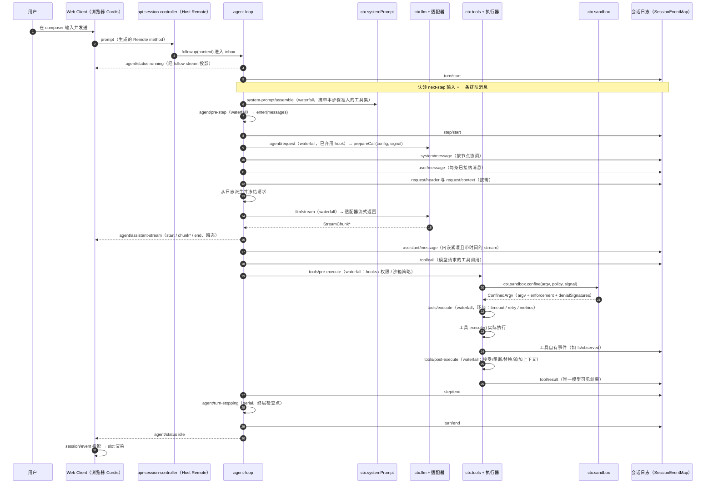

**读图要点**

1. **两条回路**：持久回路（`turn/*`、`step/*`、`*/message`、`tool/*` 进日志）与实时回路（`agent/*` 广播给 UI）。UI 的实时增量来自 `agent/assistant-stream`，重连/翻页后的一致性来自 `session/event` 与内嵌 stream（`docs/architecture.zh.md:128`）。
2. **三个 waterfall 是仅有的"打断点"**：`agent/pre-step`（决定这一步要不要走）、`llm/stream`（决定这次请求怎么发）、`tools/*`（决定这个工具调用能不能跑、结果要不要改）。
3. **工具在执行前就先落 `tool/call`**；失败步骤会记录"缺失的工具结果"（`docs/architecture.zh.md:120`）。
4. **沙箱在工具内部**，不在循环里：循环不知道沙箱存在，工具把 argv 交给 seam。
5. **UI 不参与模型链路**：它只是 `session/event` 与 `agent/*` 的消费方（`docs/architecture.zh.md:164`："添加 UI 或编辑器集成 → 驱动 `ctx.agents` 并从 `session/event` 渲染"）。

---

## ⑤ 事实核对表

用户原始文本共 9 类断言，逐条核对如下。**判定口径**：正确 = 与实现一致；部分正确 = 方向对但细节错/命名错；错误 = 与实现冲突；未验证 = 证据面内无法确认。

### 5.1 平台与内核层

| # | 用户说法 | 实际实现 | 证据 | 判定 |
|---|---|---|---|---|
| 1 | 平台抽象层 PAL 用 **Rust 编写**（如 `dsh-desktop`），用 **winit** 初始化原生窗口 | 桌面端是 **Electron**（TypeScript）壳，`dsh-desktop` 是 Electron 应用；仓库 **0 个 `.rs` 文件**，无 `winit`、`Cargo.toml` 或任何 Rust 构建产物 | `apps/desktop/README.zh.md:30`；`apps/desktop/package.json`（`electron ^44.7.0`、`electron-builder`）；`git ls-tree -r HEAD \| grep '\.rs$'` → 0 | **错误** |
| 2 | PAL "不渲染 UI、不处理业务逻辑，是纯事件路由器与平台适配器" | 概念上确实存在"平台适配"职责，但**没有独立一层**；它分散在 Electron 壳（窗口/菜单/托盘/DevTools 快捷键）+ Host 插件（sandbox-local、native directory picker、CUA）+ seam 提供方 | `docs/capability-seams.zh.md:645`、`:651`、`:730`；`docs/subsystems/sandbox.zh.md:5` | **部分正确**（职责描述合理，分层不存在） |
| 3 | Cordis 层按 **C ABI** 动态加载 `.so/.dylib/.dll`，入口 `plugin_init()` / `plugin_handle_event()` | 插件是 **ESM 模块**，由 `cordis-plugin-loader` 按 Loader 行 `import()`；**仓库与安装包内 `plugin_init`、`dlopen`、`.dylib` 零命中** | `docs/cordis-primer.zh.md:9`；`node_modules/@deepseek-ai/cordis-plugin-loader/`；`grep -rl 'plugin_init\|dlopen\|\.dylib' node_modules/@deepseek-ai` → 0 | **错误** |
| 4 | 扫描 **`~/.dsh/plugins/`** 并动态加载卸载 | 装载单位是 **profile**：`$DSH_HOME/profiles/<name>` 的 `dsh.profile.bundles` + 依赖 + patch 层；`~/.dsh/plugins/` 在官方文档与运行时代码中**零命中**（本机该目录存在，但内容是第三方 JS 插件 checkout，不被官方 loader 扫描） | `docs/architecture.zh.md:17`、`:43`；`node_modules/@deepseek-ai/dsh-app-boot/README.zh.md:50`；`grep -rn '\.dsh/plugins' docs/` → 0；`~/.dsh/plugins/dsh-boot-animation/package.json`（无官方引用） | **错误**（机制错误；目录本身存在属第三方约定，未验证） |
| 5 | 统一 IPC 通道 = **IPC Channel + serde_json** | 浏览器↔Host 走 **HTTP/WebSocket + 生成式 Remote（Typert）**；Electron 主进程↔Host 走**私有 Node IPC**（仅启动注入/就绪/致命错误/关闭）；`serde_json` 零命中 | `docs/subsystems/web-client.zh.md:28-34`；`docs/architecture.zh.md:53`；`grep -ri 'serde_json' .` → 0 | **错误** |
| 6 | Cordis 提供"服务注册与发现"，`ctx` 契约面固定服务槽 | 成立且更精确：服务由 `Service` 子类占据稳定 `ctx.<key>`；插件可**新增**服务（声明合并），不只是填固定槽位；依赖经 `inject` 声明，激活顺序由服务可用性决定 | `docs/cordis-primer.zh.md:10-11`；`docs/capability-seams.zh.md:634`（约 100 个服务，含 `service`/`seam`/`core`/`bundle` 四类角色） | **正确**（"固定"一词略强） |
| 7 | 事件总线用"约定频道"如 `session/event`、`agent/*`、`tools/*` | 三个事件域**完全正确**；但频道不是字符串约定，而是 **TypeScript 声明合并的类型化事件**，`@mode` 标签 + 生成式矩阵做交叉校验 | `docs/architecture.zh.md:71-76`；`docs/cordis-primer.zh.md:12`、`:29`；`docs/event-producer-consumer.zh.md:9` | **部分正确**（域正确、性质错误） |
| 8 | Cordis 版本与来源（用户未给版本） | `@deepseek-ai/cordis` **4.0.5**，vendor 在 `vendor/cordis`，上游作者 Shigma；加载器 `cordis-plugin-loader` / `-include` / `-timer` 同属 vendor 生态 | `node_modules/@deepseek-ai/cordis/package.json`（version / repository / author）；`docs/cordis-primer.zh.md:5`；`node_modules/@deepseek-ai/dsh/package.json` dependencies | **补充**（用户文本未提，实际必须知道） |

### 5.2 插件实现层

| # | 用户说法 | 实际实现 | 证据 | 判定 |
|---|---|---|---|---|
| 9 | 模型适配器槽位 **`ctx.llm` / `ctx.llmStreams`** | `ctx.llm` 存在且是 seam（适配器注册表 + 流式调用 API）；**`ctx.llmStreams` 不存在**（仓库与运行时零命中）；流式能力在 `ctx.llm.stream()` 与 `llm/stream` waterfall 上 | `docs/capability-seams.zh.md:656`；`docs/subsystems/llm-streaming.zh.md:984-1140`；`grep -rn 'llmStreams' .` → 0 | **部分正确**（`ctx.llm` 对，`ctx.llmStreams` 错） |
| 10 | 工具注册器 `ctx.tools`；会话日志 `ctx.sessions`（事件溯源、唯一事实来源、可回放/分叉/审计）；循环 `ctx.agentLoop`；沙箱 `ctx.sandbox`；系统提示词 `ctx.systemPrompt` | **五个全部存在**，且角色与用户描述一致：`ctx.sessions` 拥有仅追加日志并发出持久事件流；`ctx.agentLoop` 是"唯一具体循环插件"；`ctx.sandbox` 是 seam；`ctx.systemPrompt` 收集提示词段与工具 schema | `docs/capability-seams.zh.md:660`、`:697`、`:707`、`:715`、`:696`；`docs/architecture.zh.md:57-66` | **正确** |
| 11 | agent loop "观察-思考-行动，本身是插件可替换" | 循环本身确为插件，但**可替换性有边界**：`Agent` 接口与 `agent/*` 事件是扩展面，`ctx.agentLoop` 的服务角色被标为 `bundle`，官方建议扩展包依赖 `dsh-agent` 而非 `dsh-agent-loop` | `docs/capability-seams.zh.md:707`；`docs/architecture.zh.md:62-63` | **部分正确**（可替换 ≠ 随便换） |
| 12 | UI 界面"事件与 WebView 通信" | 没有任何 WebView 参与（`grep -rni 'webview' docs/` → 0）。UI 是**独立 Cordis 应用**：`dsh.client` 声明 → `__DSH_BOOT__` 图 → lazy CJS 表 → slot 注册 → `renderSlot('root')`；与 Host 通过生成式 Remote 通信 | `docs/subsystems/web-client.zh.md:22-34`；`docs/subsystems/client-modules.zh.md:5`、`:94`；`docs/subsystems/slots.zh.md:23` | **错误** |
| 13 | 沙箱：Linux `bwrap`+`Landlock`；macOS `Seatbelt`；Windows 受限 ACL 令牌 | **三平台方案完全正确**，需补三个精度：① 只管文件效果，不管网络与进程可见性；② `enforcement` 有 `full`/`partial`（旧 Landlock ABI、Windows ACL 硬链接等报 partial）；③ 消费方交的是**精确 argv**，包装由后端完成，`danger-full-access` 根本不过 seam | `docs/subsystems/sandbox.zh.md:5`、`:11`、`:19`、`:30`、`:163` | **正确**（细节补全） |
| 14 | 配置驱动：`cordis.patch.yml` 运行时热插拔 | 成立，但热插拔依赖 `dsh-hmr` 行；层序为 bundle 层 → profile patch → home patch → `--patch`；patch 是**整 config 替换**不是深合并；HMR 默认在 base 启用、Headless/SDK/ACP 禁用 | `docs/architecture.zh.md:25-27`；`node_modules/@deepseek-ai/dsh-base/cordis.patch.yml:1-14`；`node_modules/@deepseek-ai/dsh-app-boot/README.zh.md:61-63` | **正确**（条件被用户省略） |

### 5.3 设计哲学与参考项目

| # | 用户说法 | 实际实现 | 证据 | 判定 |
|---|---|---|---|---|
| 15 | "一切皆插件，没有特权化核心业务逻辑" | 哲学成立（模型适配器、工具、会话、循环、UI 全是插件），但存在**特权服务集合** `requiredIds`（`agent-loop`、`webserver`、`web-runtime`、`modules`、`connection`、`headless-runner`、`acp`、`sdk-jsonrpc-server`），缺一则启动失败 | `docs/architecture.zh.md:9`、`:11`；`node_modules/@deepseek-ai/dsh-app-boot/README.zh.md:43` | **部分正确** |
| 16 | 三层架构（PAL / Cordis 微内核 / 插件实现） | 实际应按 **五层** 理解：宿主平台（无统一 PAL 层）/ Cordis 内核 / Host 插件 / Client 插件 / 分发与配置层（bundle+profile） | 本文 ②.2；`docs/subsystems/web-client.zh.md:9-20`；`docs/architecture.zh.md:15-27` | **部分正确**（层次划分需重构） |
| 17 | 请求旅程：用户输入 → WebView UI → 事件总线 → AgentLoop → 取模型适配器 → 工具 → 沙箱 → 回 AgentLoop → 会话日志 → 回 UI | 方向正确，细节需按 ④ 修正：UI 不"发到事件总线"，而是调生成的 Remote；日志在**每一步**都写（不是最后统一写）；工具沙箱在工具内部；UI 回渲染来自 `session/event` 投影 + `agent/assistant-stream` | 本文 ④；`docs/agent-lifecycle.zh.md:10-85`；`docs/subsystems/web-client.zh.md:66-75` | **部分正确** |
| 18 | 参考项目：主仓库 `deepseek-ai/deepseek-harness`（TypeScript 实现） | **正确**：仓库 TS 为主，含 Python SDK 与 Electron 壳；无 Rust 构建 | `<DSH_REPO_CHECKOUT>` 顶层结构（`apps/{cli,desktop,desktop-host,web,plugin-market-generator}`、`packages/`、`python/`）；`git ls-tree -r HEAD \| grep -c '\.rs$'` → 0 | **正确** |
| 19 | 参考项目：Rust 移植 `DeepTrial/dsh-bash-rtk` 或 `Moresyl/dsh-studio`（Rust+Tauri） | **官方仓库与文档中零命中**（这两个名字未出现在 `<DSH_REPO_CHECKOUT>`）。外部生态里确实存在第三方同名/近似项目（npm `@deeptrial/dsh-bash-rtk`；名为 DSH Studio 的 Rust supervisor / Tauri 项目），但它们**不是官方实现**，也不构成 PAL | ⚠️ 外部检索（不可作为实现证据）：[npm @deeptrial/dsh-bash-rtk](https://www.npmjs.com/package/@deeptrial/dsh-bash-rtk)、[DSH Studio zustand 讨论](https://github.com/pmndrs/zustand/discussions/3561)、[AgentSpace: DSH Studio](https://agentspace.cc/tool/dsh-studio)；仓库内 `grep -rn 'dsh-bash-rtk\|dsh-studio' .` → 0 | **未验证 / 非官方** |
| 20 | 参考项目：插件契约 `dsh-plugin-contract`（C ABI） | 仓库内零命中。官方插件契约是 **Cordis `apply(ctx, config)` + `dsh` 清单字段**；一份第三方 DSH 插件构建参考也把"plugin form and apply"指向 Cordis 教程，未提任何 C ABI | `grep -rn 'dsh-plugin-contract' <DSH_REPO_CHECKOUT>` → 0；`docs/cordis-primer.zh.md:9`；⚠️ 第三方：[dsh-evoforge dsh-contract.md](https://github.com/deepseek-harness-evoforge/dsh-evoforge/blob/e8dada4ac0dd277ca89fc8e1e19b82799badd093/skills/build-dsh-plugin/references/dsh-contract.md) | **错误** |
| 21 | "事件溯源可回放、可分叉、可审计" | 成立：仅追加日志 + `deriveMessages()` + `fork(boundary)` + JSONL generation（`session.vN.jsonl`）+ 投影 seam | `docs/architecture.zh.md:128-134`；`docs/subsystems/session.zh.md:675-692`、`:810-814` | **正确** |
| 22 | "极致解耦可扩展" | 成立，且有量化证据：305 个包、78 个声明 `dsh.client` 的包（其中 54 个 `ui-*`）、18 个 bundle、约 100 个 `ctx.*` 服务、80+ 个类型化事件 | `node_modules/@deepseek-ai/dsh/node_modules/@deepseek-ai/` 实测统计；`docs/capability-seams.zh.md:634-739`；`docs/event-producer-consumer.zh.md:11-96` | **正确** |

### 5.4 核对结论

- **用户文本的价值**：抓住了 DSH 的骨架——Cordis 内核、一切皆插件、服务槽位、事件三域、事件溯源、沙箱三平台、patch 驱动。作为"架构直觉"是准确的。
- **用户文本的问题**：把"一个**想象中**的 Rust/原生宿主"和"一个**真实存在的** TypeScript/Cordis 宿主"缝在了一起。PAL 章节几乎全错（Rust、winit、C ABI、.so、serde_json、~/.dsh/plugins），而这些错误会直接导致错误的工程决策——例如"我要写个 Rust 插件"或"把插件丢进 `~/.dsh/plugins` 就会生效"。
- **对下游文档的影响**：Doc2 评估 composer-assist 时**绝不能沿用用户文本的 PAL/C ABI 假设**；判断依据必须是 Cordis 插件契约 + `dsh.client` + slot + Remote（本文 ③.3 已给出）。

---

## ⑥ 设计哲学：哪些成立，哪些被现实修正

### 6.1 成立的五条

| 哲学主张 | 为什么成立 | 反例边界 |
|---|---|---|
| **一切皆插件** | 模型适配器、工具、会话日志、系统提示词、agent loop、UI 全是插件；`docs/capability-seams.zh.md` 里约 100 个 `ctx.*` 服务全部由包声明 | `requiredIds` 是特权服务集合（见 6.2-①） |
| **无特权业务逻辑** | 新增模型/工具/命令/UI 都不需要改核心；官方"新行为归属位置"表把 20 种扩展映射到既有扩展点 | 想改循环本身仍要理解 `Agent` 接口与 `agent/*` 事件，门槛不在"特权"而在"契约密度" |
| **可逆副作用** | 所有注册都挂在 fiber 上，卸载即撤销；HMR 敢直接重组整棵树就是靠这条 | 裸资源（定时器/子进程/句柄）不放进 `ctx.effect` 就泄漏，责任在作者 |
| **事件驱动解耦** | 三个事件域 + 五种分发模式，让"策略"可以跨工具族生效而不与工具耦合（`tools/*` + `approval/request` 就是范例） | waterfall 必须委托；漏了 `next()` 是静默故障 |
| **事件溯源** | 仅追加日志 + `deriveMessages()` + fork + generation 化 JSONL，可回放、可分叉、可审计 | 私自 append 新 `type` 会毁掉会话可打开性 |

### 6.2 被现实修正的五条

| 用户/流行叙事 | 现实修正 | 证据 |
|---|---|---|
| ① "没有特权内核" | 有**特权服务契约**：8 个 `requiredIds` 缺失则整体启动失败 | `node_modules/@deepseek-ai/dsh-app-boot/README.zh.md:43` |
| ② "微内核 = 小而稳定的核心" | 内核小，但**契约面极宽**：约 100 个服务 + 80+ 事件 + 5 种分发模式 + Loader/patch 语义。学习曲线不在内核代码量，而在契约面 | `docs/capability-seams.zh.md:634-739`；`docs/event-producer-consumer.zh.md:11-96` |
| ③ "插件可热插拔" | 有条件：依赖 `dsh-hmr`；无 HMR 时启动期组合不可删，只能报 `restart-required`；替换版本还要处理模块逐出与 runtime resolution 发布 | `packages/boot/plugin-manager/README.zh.md:122-126` |
| ④ "配置驱动、改 YAML 就生效" | patch 是**整 config 替换**不是深合并；上游删行后 override 被跳过（`--dump-config` 会报 `patch: entry "id" not found`）；空 patch 文件会导致启动失败 | `node_modules/@deepseek-ai/dsh-base/cordis.patch.yml:1-14`；`node_modules/@deepseek-ai/dsh-app-boot/README.zh.md:61` |
| ⑤ "UI 插件就是前端组件库" | UI 插件是**独立 Cordis 应用的一部分**：要声明 `dsh.client`、处理模块图/rev/HMR、遵守 slot 所有权与 effect 生命周期；DOM 结构与 CSS 变量不属契约 | `docs/subsystems/client-modules.zh.md:88-98`；`docs/subsystems/slots.zh.md:203-210` |

### 6.3 一句话总结这套架构的取舍

DSH 用"**把一切都做成插件**"换来了可替换性与可观测性，代价是**契约面极宽 + 失效静默**：装错的插件往往不报错，只是"没反应"；写错的 waterfall 往往不报错，只是"某个策略突然不生效"；升级后往往不报错，只是"UI 那一小块不见了"。理解这一点，是读 Doc2 的前提。

---

## ⑦ 插件层 → dsh-composer-assist 的能力映射（承上启下）

本节**只做映射，不展开问题**。右列"Doc2 议题"是给下游文档的锚点编号；具体分析见姊妹篇 [2026-10-24-composer-assist-review.md](./2026-10-24-composer-assist-review.md)（与本篇同目录）。

### 7.1 它用到了哪些插件层机制

| # | DSH 机制（本文小节） | composer-assist 的具体用法 | 证据（仓库只读） | 契约等级 | Doc2 议题 |
|---|---|---|---|---|---|
| M1 | **bundle 形态**（③.3.1） | `dsh.bundle.patch → ./cordis.patch.yml`，patch 只有一条 `insert`: `id: composer-assist` / `name: dsh-composer-assist` | `<PLUGIN_CHECKOUT>/package.json`；`cordis.patch.yml:1-3` | A | 分发形态是否够用 |
| M2 | **Host 插件**（③.3.2） | `index.js` 导出 Host 半边；依赖 `ctx.llm`、`ctx.connection`、`ctx.sessions` 等 | `<PLUGIN_CHECKOUT>/index.js:508`（`ctx.inject(['llm','connection','sessions'], ...)`） | A | Host 侧职责边界 |
| M3 | **Client 插件**（③.3.1 / ③.3.8） | `dsh.client { platform:'web', immediately:true, inject:[ui-conversation, ui-settings, ui-settings-general] }`；`client.js` 1392 行 | `package.json` 的 `dsh.client`；`client.js` 全文 | A（声明面）/ C（内部实现） | 单文件 1392 行的可维护性 |
| M4 | **`ctx.llm` seam + `prepareCall`**（③.3.3 / ③.3.5 末） | 用 `ctx.llm.prepareCall({...route, maxTokens}, signal, configure)` 发辅助模型调用，`configure` 里选推理强度 | `index.js:396` | A | 辅助调用是否计入会话/能否取消 |
| M5 | **`ctx.get('agentDefaultModel')` 读回退**（③.3.3 C 级） | 无显式模型选择时读默认选择 | `index.js:337` | C（不要求 inject，但属内部读） | 默认模型解析的稳定性 |
| M6 | **`agent/turn-stopping` serial 事件**（③.3.4） | `scoped.on('agent/turn-stopping', ...)` 记录"一轮结束"，用于触发下一条建议 | `index.js:563` | B（事件公开，语义是终局检查点） | 轮次边界作为触发器是否可靠 |
| M7 | **slot 注册**（③.3.8） | 4 处 `ctx.slots.register`：`conversation.input.dock`、`conversation.input.left`（预测）、`conversation.input.left`（润色）、`settings.section` | `client.js:1355-1368` | A（API）/ B（个别 key 的语义） | slot 选择是否稳定、是否会被 hover/布局挤掉 |
| M8 | **locale namespace**（③.3.8） | `locale: NS`（`NS='composerAssist'`）+ `locale/*.json` | `client.js:14`、`:1356` | A | i18n 覆盖是否完整 |
| M9 | **宿主 DOM 标记 / CSS 变量**（③.3.8 D 级） | 读 `[data-composer-card] [data-composer-input]`、写 `--dsh-composer-hint`、设 `data-composer-assist-continuation` | `client.js:268-346`（选择器与属性名） | **D（非契约）** | 升级静默失效的头号风险 |
| M10 | **Host HTTP 路由 + 本地文件 settings**（③.3.9 的旁路） | 自建 `/api/composer-assist/settings`；设置落盘 `$DSH_HOME/composer-assist/settings.json` | `index.js:12`；`index.js:58` | C（绕过 `ctx.settings`/`ctx.configEditor`） | 双轨配置与 profile 迁移风险 |
| M11 | **版本兼容声明**（③.3.10） | `package.json` **无 `engines.dsh`、无 `peerDependencies`、无 `devDependencies`**（宿主包全缺） | `<PLUGIN_CHECKOUT>/package.json`（对照 `node_modules/@deepseek-ai/dsh-client-ui-theme/package.json` 有 `peerDependencies`） | — | 0.2.1 升级准入与 `ERR_MODULE_NOT_FOUND` 风险 |
| M12 | **展示元数据**（③.3.8 locale/icon） | `exports["./icon"]`、`exports["./locale/*.json"]`、`exports["./package.json"]` 均已导出 | `package.json` `exports` | A | 0.2.1 图标/locale 规则变更是否命中 |

### 7.2 映射出来的四条主线（交给 Doc2 展开）

1. **形态主线**：一个包同时承担 bundle + Host 插件 + Client 插件三种形态（M1–M3）——好处是一个包搞定，坏处是**三类失效模式混在一个版本号下**。
2. **契约主线**：A 级契约（`ctx.llm`、slot API、`agent/turn-stopping`）与 D 级事实（DOM 标记、CSS 变量）混用（M4–M9）——稳定性评级必须逐项拆开，不能笼统说"依赖 DSH 接口"。
3. **配置主线**：绕过 `ctx.settings`/`ctx.configEditor` 自建 HTTP 路由与 JSON 文件（M10）——与 profile 分层、HMR、`--dump-config` 的关系需要单独论证。
4. **兼容主线**：缺 `engines.dsh` 与 `peerDependencies`（M11）——在 0.2.1 的强制准入下，这是"今天能跑、升级即静默死"的典型结构。

---

## 附录 A：证据索引与自查方法

### A.1 主要证据文件

| 类别 | 文件 | 用途 |
|---|---|---|
| 总览 | `docs/architecture.zh.md` | 分层、核心包表、事件三域、轮次流程、会话日志、新行为归属 |
| 服务 | `docs/capability-seams.zh.md` | 约 100 个 `ctx.*` 的角色/提供方/消费者全表 |
| 事件 | `docs/event-producer-consumer.zh.md` | 事件模式、声明位置、产销边 |
| 生命周期 | `docs/agent-lifecycle.zh.md` | 轮次/步骤时序图（真实事件名） |
| Cordis | `docs/cordis-primer.zh.md`、`docs/cordis-api/{context,events,fiber,service,registry}.zh.md` | 五概念、五分发模式、`ctx.effect/on/inject/get` |
| 工具 | `docs/tool-execution-pipeline.zh.md`、`docs/subsystems/tools.zh.md` | 管线图、`ToolDefinition`、`ctx.tools` API |
| 会话 | `docs/subsystems/session.zh.md` | `SessionEventMap`、`deriveMessages`、fork、持久化约定 |
| 沙箱 | `docs/subsystems/sandbox.zh.md` | 三平台后端、`SandboxMode`、`confine`、fail-closed |
| Web | `docs/subsystems/{web-client,client-modules,slots}.zh.md` | 分层、`__DSH_BOOT__`、slot 层级与规则 |
| 主题 | `docs/web-styling.zh.md`、`docs/ui-radius.zh.md` | `--dsw-*` token 归属与规则 |
| 启动/配置 | `node_modules/@deepseek-ai/dsh-app-boot/README.zh.md`（仓库对应 `packages/boot/app-boot/README.zh.md`） | profile、patch 层序、`engines.dsh` 规则、runtime resolution |
| 插件管理 | `packages/boot/plugin-manager/README.zh.md` | 安装/更新/豁免、HMR 与 `restart-required` |
| 升级 | `docs/upgrade-guide/v0.2.1-*/`、`v0.2.0-rc.2/` | 破坏性变更逐条 |
| 桌面 | `apps/desktop/README.zh.md`、`apps/desktop/package.json`、`apps/desktop/cli/link-entry.c` | Electron 壳、唯一的 C 源码 |
| 清单样本 | `node_modules/@deepseek-ai/dsh-client-ui-theme/package.json`、`dsh-base/{package.json,cordis.patch.yml}`、`dsh-web-app/cordis.patch.yml` | `dsh.client` / `dsh.bundle` / patch 行写法 |
| 本机 profile | `~/.dsh/profiles/web/{package.json,cordis.patch.yml}` | 真实五层叠加与树外 bundle 混编 |

### A.2 每个事实怎么复核（建议随文档一起跑）

```bash
# 1) 版本与包统计
dsh --version
ls ~/.npm-global/lib/node_modules/@deepseek-ai/dsh/node_modules/@deepseek-ai | wc -l

# 2) 服务槽位是否存在
grep -rn 'ctx\.llm\b' docs/capability-seams.zh.md | head
grep -rn 'llmStreams' <DSH_REPO_CHECKOUT> <DSH_INSTALL_DIR>/node_modules/@deepseek-ai || echo "llmStreams 零命中（反例）"

# 3) 事件名与声明位置
grep -n 'agent/turn-stopping' docs/event-producer-consumer.zh.md

# 4) 平台事实（应当全部零命中）
cd <DSH_REPO_CHECKOUT> && git ls-tree -r --name-only HEAD | grep -c '\.rs$'
grep -rn 'winit\|serde_json\|plugin_init\|\.dylib' . --include='*.md' --include='*.ts' --include='*.json' | head

# 5) 本机真实配置树
dsh --profile web --dump-config | head -40
```

### A.3 本文的"反例字符串"清单（故意出现但**应当**零命中）

为便于核对，这里显式列出文中作为**否定证据**出现的字符串；它们**不应**在证据面命中，命中反而说明判断有误：

`winit` · `serde_json` · `plugin_init` · `plugin_handle_event` · `.dylib` · `ctx.llmStreams` · `dsh-plugin-contract` · `~/.dsh/plugins`（作为官方扫描机制）

---

## 附录 B：未验证清单（明确交回给读者/后续文档）

| # | 未验证项 | 原因 | 可能的验证方式 |
|---|---|---|---|
| B1 | `~/.dsh/plugins/` 目录的**官方**语义 | 官方文档与运行时源码零命中；本机该目录只有一个第三方插件 checkout | 若需要，请查第三方插件管理器文档；或运行 `dsh --dump-config` 看是否有该目录来源的行 |
| B2 | `DeepTrial/dsh-bash-rtk`、`Moresyl/dsh-studio`、`dsh-plugin-contract` 的**真实归属与内容** | 官方仓库零命中；仅外部检索到近似第三方项目，链接属外部不可信数据 | 访问对应 GitHub/npm 页面确认作者与实现语言 |
| B3 | Client 侧 slot `conversation.composer.bar` 等 key 的**长期稳定性** | 官方只承诺 slot 系统语义与扩展规则，未承诺具体 key 不重命名 | 盯 `cordis_inspect what:"client"` 的 catalog 与 upgrade-guide 中 client-ui 相关条目 |
| B4 | `agent/turn-stopping` 在**所有**轮次结束路径上都会触发 | 官方定义为 serial 终局检查点，但取消/崩溃路径是否总到达未逐一验证 | 写一个监听器打点，覆盖 正常结束/取消/工具错误/进程硬杀 四种场景 |
| B5 | `dsh-composer-assist` 与本机 0.2.1-rc.2 的**实际运行兼容性** | 本文只做静态架构映射，未安装、未启动该插件 | 由 Doc2 第 4 角度或后续冒烟验证（装进测试 profile → `--dump-config` → UI 实操）。**后续核实（host-contract，见 Doc2 §5）**：`prepareCall(config, signal, configure)`、`agent/turn-stopping`、slot 注册、`ctx.get` 语义在 0.2.1-rc.2 源码中均成立；运行时实操仍未做 |
| B6 | `--dsh-composer-hint` 等变量的**来源**（是 DSH 官方变量还是插件自造） | 官方 `docs/web-styling.zh.md` 只列 `--dsw-*`，未见 `--dsh-*` 前缀的**文档契约** | 用 `grep -rn '\-\-dsh-' docs/` 与安装包 CSS 交叉核对。**后续核实（host-contract）**：这些是 DSH 官方**内部实现**——`--dsh-composer-hint` 由 `ui-conversation/src/client/input/editor/DraftEditor.tsx:53` 写入、`InputBar.module.css:202-207` 消费；`data-composer-card/input/placeholder` 定义在 `InputBar.tsx:417` / `ComposerContentEditable.tsx:46` / `DraftEditor.tsx:56`；无任何文档承诺（详见 Doc2 M1） |

---

## 附录 C：术语速查（本文出现的英文术语）

| 术语 | 含义（按 DSH 语义） |
|---|---|
| **seam** | 可替换能力的三元组：Service Definition（拥有 `ctx.<key>`）+ Service Provider + Consumer；绝不是 TS `interface`（`docs/glossary.zh.md:9`） |
| **Service / Provider / Consumer** | 声明接口与词汇的服务类 / 实现它并注册的包 / 注入并使用的包 |
| **bundle（组合包）** | 带配置层的 npm 包，声明 `dsh.bundle.patch`；插入内容可被上层 patch |
| **profile** | `$DSH_HOME/profiles/<name>` 下的具名组装，声明 `dsh.profile.bundles` + 自己的 patch |
| **patch 层** | 按 id 定位条目并替换整个 config、或插入新条目的 YAML 列表 |
| **fiber** | 一个已加载的插件实例（生命周期状态 + 校验后配置 + 注册的 effect） |
| **effect** | fiber 拥有的可逆副作用；返回 disposer |
| **waterfall** | 环绕中间件式事件分发；监听器必须 `next()` 才能委托 |
| **turn / step** | 一次对已接纳输入的排空过程 / 一次模型请求加上它调用的工具 |
| **slot** | Web Client 的类型化 React 组合点（cardinality + scope + props 推导） |
| **Remote** | Host 服务经 Typert 生成的类型化调用面（`ctx.remote.<ns>`） |
| **PTC** | 程序化工具调用（programmatic tool calling），`run_code` 传输 + 序列化子调用走同一工具管线 |
| **HMR** | 模块与配置热重载；串行化队列，与插件管理写入共队列 |

---

## 结语

把这份文档压缩成一句可执行的话：**DSH 的"内核"不是代码，而是契约面**——`ctx.<服务>` 的槽位、`agent/*`/`session/event`/`tools/*` 的事件语义、`apply` 的可逆生命周期、`engines.dsh` 的准入规则。理解并尊重这四样东西，插件就能"装上去就生效、升级后仍生效"；把它们当成随手可读可写的内部实现，插件就会以**静默失效**的方式坏掉。

Doc2 将在此底座上，对 `dsh-composer-assist` 做工程化、文档漂移、新老冲突与 DSH 维护面四个角度的评估。

---

*文档版本：v1.0 ｜ 证据基线：DSH `0.2.1-rc.2` + 官方仓库 commit `22ddee3` ｜ 若运行时升级，请先重跑附录 A.2 的五组命令再引用本文结论。*

